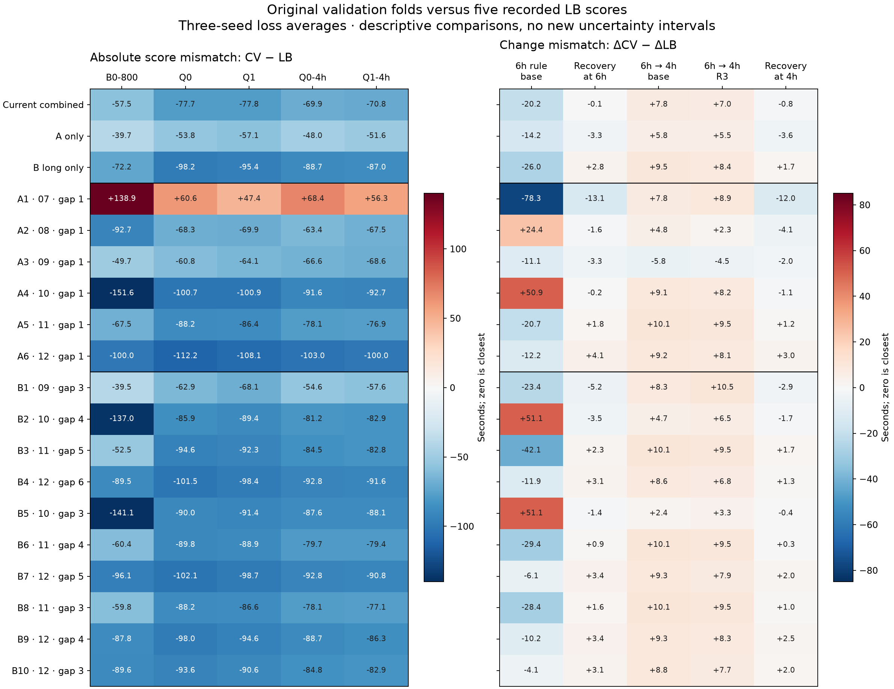

# Original fold alignment with the five recorded leaderboard scores

Exploratory analysis requested 2026-09-17. No fits, uploads or fold-definition changes.
Official reference timestamp: 2026-09-16T16:46:32+00:00. All values are RMSE seconds.

## What the current headline averages

The combined score uses **A1–A6 and B3/B4/B7**. Other B folds are diagnostics. Losses are averaged across seeds and repeated predictions of a flight before pooling; fold RMSEs are never averaged arithmetically. The A/long-B weights remain the fixed January/July ranking-population weights.

| Validation month | Effective combined squared-error weight |
|---|---:|
| 2025-07 | 7.824% |
| 2025-08 | 7.843% |
| 2025-09 | 7.546% |
| 2025-10 | 7.617% |
| 2025-11 | 34.232% |
| 2025-12 | 34.937% |

## Every individual fold

Level error is mean |CV−LB| over five candidates. Change error is mean |ΔCV−ΔLB| over the five fixed pairs. Direction uses the same 1-second tolerance; only three LB changes exceed it. All three concern the Rome rule, so 3/3 is limited evidence.

| Fold | Train | Validate / gap | In headline? | Level error | Change error | Directions / 3 |
|---|---|---|---|---:|---:|---:|
| A1 | 2025-01–2025-06 | 2025-07 / 1 | yes | 74.31 | 24.03 | 2/3 |
| A2 | 2025-02–2025-07 | 2025-08 / 1 | yes | 72.34 | 7.46 | 3/3 |
| A3 | 2025-03–2025-08 | 2025-09 / 1 | yes | 61.95 | 5.35 | 3/3 |
| A4 | 2025-04–2025-09 | 2025-10 / 1 | yes | 107.51 | 13.89 | 2/3 |
| A5 | 2025-05–2025-10 | 2025-11 / 1 | yes | 79.42 | 8.65 | 1/3 |
| A6 | 2025-06–2025-11 | 2025-12 / 1 | yes | 104.67 | 7.32 | 2/3 |
| B1 | 2025-01–2025-06 | 2025-09 / 3 | diagnostic | 56.54 | 10.05 | 2/3 |
| B2 | 2025-01–2025-06 | 2025-10 / 4 | diagnostic | 95.27 | 13.49 | 2/3 |
| B3 | 2025-01–2025-06 | 2025-11 / 5 | yes | 81.36 | 13.17 | 1/3 |
| B4 | 2025-01–2025-06 | 2025-12 / 6 | yes | 94.76 | 6.35 | 3/3 |
| B5 | 2025-02–2025-07 | 2025-10 / 3 | diagnostic | 99.64 | 11.74 | 2/3 |
| B6 | 2025-02–2025-07 | 2025-11 / 4 | diagnostic | 79.65 | 10.06 | 1/3 |
| B7 | 2025-02–2025-07 | 2025-12 / 5 | yes | 96.12 | 5.74 | 2/3 |
| B8 | 2025-03–2025-08 | 2025-11 / 3 | diagnostic | 77.94 | 10.13 | 1/3 |
| B9 | 2025-03–2025-08 | 2025-12 / 4 | diagnostic | 91.08 | 6.73 | 2/3 |
| B10 | 2025-04–2025-09 | 2025-12 / 3 | diagnostic | 88.29 | 5.11 | 3/3 |

## Raw scores and controlled changes

| Fold | B0-800 | Q0 | Q1 | Q0-4h | Q1-4h |
|---|---:|---:|---:|---:|---:|
| Official LB | 406.43 | 354.43 | 354.00 | 344.31 | 344.48 |
| A1 | 545.28 | 414.99 | 401.45 | 412.67 | 400.82 |
| A2 | 313.76 | 286.17 | 284.15 | 280.90 | 276.97 |
| A3 | 356.78 | 293.64 | 289.88 | 277.72 | 275.89 |
| A4 | 254.83 | 253.70 | 253.12 | 252.71 | 251.75 |
| A5 | 338.91 | 266.24 | 267.57 | 266.24 | 267.57 |
| A6 | 306.41 | 242.23 | 245.87 | 241.31 | 244.49 |
| B1 | 366.89 | 291.53 | 285.93 | 289.68 | 286.92 |
| B2 | 269.47 | 268.54 | 264.62 | 263.12 | 261.56 |
| B3 | 353.92 | 259.78 | 261.68 | 259.78 | 261.68 |
| B4 | 316.88 | 252.96 | 255.63 | 251.47 | 252.92 |
| B5 | 265.31 | 264.42 | 262.59 | 256.70 | 256.42 |
| B6 | 346.02 | 264.60 | 265.10 | 264.60 | 265.10 |
| B7 | 310.36 | 252.30 | 255.26 | 251.48 | 253.67 |
| B8 | 346.64 | 266.24 | 267.41 | 266.24 | 267.41 |
| B9 | 318.65 | 256.43 | 259.39 | 255.58 | 258.21 |
| B10 | 316.86 | 260.81 | 263.45 | 259.46 | 261.62 |

| Fold | Six-hour rule | Recovery at 6h | 6h→4h baseline | 6h→4h recovery | Recovery at 4h |
|---|---:|---:|---:|---:|---:|
| Official LB | -52.00 | -0.43 | -10.12 | -9.52 | +0.17 |
| A1 | -130.30 | -13.54 | -2.31 | -0.62 | -11.85 |
| A2 | -27.59 | -2.02 | -5.28 | -7.18 | -3.93 |
| A3 | -63.13 | -3.76 | -15.92 | -13.99 | -1.83 |
| A4 | -1.13 | -0.58 | -0.99 | -1.37 | -0.96 |
| A5 | -72.67 | +1.34 | +0.00 | +0.00 | +1.34 |
| A6 | -64.18 | +3.64 | -0.93 | -1.38 | +3.18 |
| B1 | -75.36 | -5.60 | -1.84 | +0.99 | -2.77 |
| B2 | -0.93 | -3.92 | -5.42 | -3.06 | -1.56 |
| B3 | -94.13 | +1.90 | +0.00 | +0.00 | +1.90 |
| B4 | -63.92 | +2.66 | -1.50 | -2.71 | +1.45 |
| B5 | -0.89 | -1.83 | -7.72 | -6.17 | -0.27 |
| B6 | -81.42 | +0.49 | +0.00 | +0.00 | +0.49 |
| B7 | -58.05 | +2.96 | -0.82 | -1.59 | +2.19 |
| B8 | -80.40 | +1.17 | +0.00 | +0.00 | +1.17 |
| B9 | -62.22 | +2.96 | -0.86 | -1.18 | +2.63 |
| B10 | -56.05 | +2.64 | -1.35 | -1.83 | +2.15 |

## Alternative summaries and deletion checks

All subsets below are exploratory and chosen after inspecting these results. No optimized weights or exhaustive subset search was used. A+B variants preserve the existing A/B mixing weights; pooling within each group respects unique flights.

| Summary | Level error | Change error | Threshold-change error | Recovery-change error | Directions / 3 | Seed-42 level / change | Fits × 3 seeds if run alone |
|---|---:|---:|---:|---:|---:|---|---:|
| current_combined | 70.73 | 7.19 | 7.40 | 0.47 | 3/3 | 70.84 / 7.42 | 18 |
| A_only | 50.05 | 6.46 | 5.65 | 3.41 | 3/3 | 50.20 / 6.62 | 18 |
| B_long_only | 88.33 | 9.69 | 8.99 | 2.24 | 2/3 | 88.39 / 9.37 | 6 |
| all16_pooled | 47.42 | 7.21 | 6.37 | 3.72 | 3/3 | 47.53 / 7.41 | 18 |
| A_Jul_Sep | 17.52 | 9.79 | 3.22 | 6.79 | 3/3 | 17.65 / 10.12 | 9 |
| A_Oct_Dec | 97.17 | 5.37 | 9.04 | 1.35 | 1/3 | 97.44 / 5.54 | 9 |
| A_Aug_Sep | 67.10 | 2.65 | 0.71 | 2.76 | 3/3 | 67.47 / 2.58 | 6 |
| A_Jul_Sep_plus_long | 52.58 | 8.74 | 6.11 | 2.31 | 3/3 | 52.65 / 9.04 | 9 |
| A_Jul_Sep_plus_Dec_long | 56.06 | 6.87 | 5.68 | 2.24 | 3/3 | 56.20 / 7.23 | 9 |
| drop_A1 | 86.37 | 5.57 | 7.04 | 1.00 | 3/3 | 86.55 / 5.37 | 18 |
| drop_A2 | 68.58 | 7.99 | 7.59 | 0.54 | 3/3 | 68.63 / 8.20 | 18 |
| drop_A3 | 69.60 | 7.68 | 8.40 | 0.55 | 3/3 | 69.72 / 7.85 | 15 |
| drop_A4 | 65.72 | 8.15 | 7.12 | 0.74 | 3/3 | 65.81 / 8.38 | 15 |
| drop_A5 | 68.39 | 7.11 | 7.07 | 0.86 | 3/3 | 68.52 / 7.36 | 15 |
| drop_A6 | 66.48 | 7.33 | 7.16 | 1.00 | 3/3 | 66.55 / 7.58 | 15 |
| drop_B3 | 74.44 | 5.23 | 6.96 | 0.48 | 3/3 | 74.62 / 5.47 | 18 |
| drop_B4 | 70.90 | 7.07 | 7.52 | 0.40 | 3/3 | 70.86 / 7.22 | 18 |
| drop_B7 | 70.56 | 7.32 | 7.28 | 0.53 | 3/3 | 70.81 / 7.62 | 18 |
| drop_month_2025-07 | 86.37 | 5.57 | 7.04 | 1.00 | 3/3 | 86.55 / 5.37 | 18 |
| drop_month_2025-08 | 68.58 | 7.99 | 7.59 | 0.54 | 3/3 | 68.63 / 8.20 | 18 |
| drop_month_2025-09 | 69.60 | 7.68 | 8.40 | 0.55 | 3/3 | 69.72 / 7.85 | 15 |
| drop_month_2025-10 | 65.72 | 8.15 | 7.12 | 0.74 | 3/3 | 65.81 / 8.38 | 15 |
| drop_month_2025-11 | 72.07 | 5.12 | 6.63 | 0.78 | 3/3 | 72.28 / 5.43 | 15 |
| drop_month_2025-12 | 62.81 | 9.28 | 7.60 | 1.08 | 3/3 | 62.82 / 9.48 | 15 |

Fit counts refer to running only that summary. Removing B evaluations while retaining all A folds saves **no model fits**, since B reuses A models.

## Concentration of baseline rule gains

Counts are unique flights per fold; losses are averaged across seeds. The largest-row share is its contribution to the net squared-error gain, so harmed rows can make a share exceed 100%. The same flights recur in different training-origin folds.

| Fold | Six-hour flights | Extra four-hour flights | Largest extra flight share of net gain | Q0-4h ordinary RMSE |
|---|---:|---:|---:|---:|
| A1 | 16 | 23 | 28.8% | 353.86 |
| A2 | 10 | 7 | 106.1% | 265.42 |
| A3 | 9 | 6 | 55.9% | 254.73 |
| A4 | 1 | 4 | 57.2% | 243.76 |
| A5 | 4 | 0 | — | 242.85 |
| A6 | 4 | 2 | 98.3% | 234.97 |
| B1 | 9 | 6 | 37.3% | 269.37 |
| B2 | 1 | 4 | 76.6% | 254.44 |
| B3 | 4 | 0 | — | 236.42 |
| B4 | 4 | 2 | 96.2% | 245.71 |
| B5 | 1 | 4 | 81.9% | 246.91 |
| B6 | 4 | 0 | — | 241.03 |
| B7 | 4 | 2 | 97.6% | 244.88 |
| B8 | 4 | 0 | — | 243.19 |
| B9 | 4 | 2 | 85.8% | 249.75 |
| B10 | 4 | 2 | 75.4% | 253.51 |

## Interpretation

- September A3 is the most promising individual fold on both score level and change size versus the current combined reference. August+September is a strong exploratory change readout. Its threshold result is sparse: A3 adds six flights, with one supplying about 56% of net gain. The older-origin September B1 sees the same flights but much less gain.
- November cannot detect the 4h-vs-6h threshold change; December has only two extra cases. That explains why the long-gap score underestimates this particular intervention.
- July is much harder even on ordinary flights and outside Rome. Removing it improves some change metrics but substantially worsens absolute score closeness and removes our only summer July evaluation.
- Recovery improves summer folds; A5/A6 and all three headline long-gap folds (B3/B4/B7) regress under every seed. Removing winter coverage risks exaggerating recovery, as the seasonal experiments did. The current mixture is especially close to the tiny observed recovery LB changes.
- A-only is closer in levels and average changes than the current combined score, but has larger errors on the recovery comparisons. July–September is closest in levels while overstating recovery/rule gains. These are different tradeoffs, not one clear winner.
- Retain the current folds while recording these alternate summaries. Treat R_A as the primary next-month readout and keep long-gap results as a separate guardrail; the protocol already treats their combined number as provisional. Confirm any proposed reduction with a later candidate before changing the benchmark.

## Evidence limits and reproducibility

The original prediction parquets are absent here. Saved per-fold SSE/count/seed summaries reproduce the existing A, long-B and combined values exactly. They support these point estimates and seed checks, but not new paired day-bootstrap intervals or a significance claim that one fold/subset aligns better. Restore prediction artifacts for those checks; no model refit is needed merely to inspect saved predictions.
The five submissions use only two parent models and highly related rule variants. Selecting folds against them is calibration on those observations, not independent validation. Opposite signs on sub-second LB changes are not counted as failures, but large predicted recovery gains remain visible in change-error metrics.

Reproduce: `.venv/bin/python VALIDATION/tools/analyze_fold_alignment.py`.
All four seed readouts, individual deltas, exact subset memberships, source hashes and slice diagnostics are in `fold_alignment.json`; tabular metrics are in `fold_alignment.csv`.

