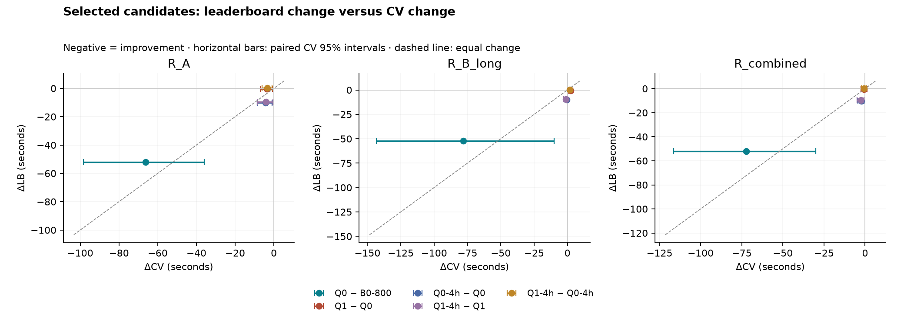

# Selected leaderboard results versus CV

Official team-bucket results checked **2026-09-16T16:46:32+00:00**. Lower RMSE is better.

Live leaderboard snapshot **2026-09-16T16:46:48+00:00**: rank **96/152** scoring teams (416 registered). Best: unique-rose_v15.parquet at 344.3114; latest: unique-rose_v16.parquet at 344.4821. [Saved live snapshot](leaderboard_live_20260916.json).

The five candidates were selected before these official scores. Final models use seed 42, 800 rounds, all twelve 2025 months and the original 27 features. Two model fits supply all five files; no CV models were refitted. Six-hour Q0/Q1 identities are preserved.

## Findings

**Best observed candidate: Q0-4h / v15, 344.3114 s.** This improves on the matched B0-800 submission by 62.1167 s (15.28%). All five scored successfully on 344,841 rows.

The six-hour rule and both reductions from six to four hours improve LB, agreeing with all three standard CV point-estimate directions. The magnitudes differ: Q0 − B0-800 is -51.9978 s on LB versus -72.2395 s in combined CV; Q0-4h − Q0 is -10.1189 s versus -2.3668 s.

Recovery changes LB by -0.4299 s at six hours and 0.1707 s at four hours. Its next-month CV gain and longer-gap CV regression disagree with each other; its combined intervals include zero. Recovery is not a consistent improvement across the two LB controls. The four-hour recovery comparison also disagrees with combined CV point-estimate direction.

For the best candidate, LB minus standard combined CV is 69.9407 s. Directional transfer does not make CV an accurate absolute leaderboard forecast.

The rule-transfer evidence supports discussing the proposed training-routing experiment next. No new training exclusion or rule-correction model has been implemented. Four hours is the best observed candidate in this selected comparison, not a proven global optimum.

## Score levels and LB minus CV

Standard CV averages squared error across three seeds and repeated origins before taking the square root. Seed-42 CV is a secondary comparison with the final model seed. Neither table averages predictions.

### standard

| Candidate / version | Official LB | CV next month | CV longer gap | CV combined | LB − next month | LB − longer gap | LB − combined |
|---|---:|---:|---:|---:|---:|---:|---:|
| B0-800 / v12 | 406.4281 | 366.7465 | 334.1785 | 348.9770 | 39.6816 | 72.2496 | 57.4511 |
| Q0 / v13 | 354.4303 | 300.5904 | 256.1971 | 276.7374 | 53.8399 | 98.2332 | 77.6929 |
| Q1 / v14 | 354.0004 | 296.9037 | 258.5505 | 276.1937 | 57.0967 | 95.4499 | 77.8067 |
| Q0-4h / v15 | 344.3114 | 296.2785 | 255.6200 | 274.3707 | 48.0329 | 88.6914 | 69.9407 |
| Q1-4h / v16 | 344.4821 | 292.8785 | 257.4787 | 273.7215 | 51.6036 | 87.0034 | 70.7606 |

### seed42

| Candidate / version | Official LB | CV next month | CV longer gap | CV combined | LB − next month | LB − longer gap | LB − combined |
|---|---:|---:|---:|---:|---:|---:|---:|
| B0-800 / v12 | 406.4281 | 366.4844 | 334.3275 | 348.9345 | 39.9437 | 72.1006 | 57.4936 |
| Q0 / v13 | 354.4303 | 300.5811 | 256.4420 | 276.8593 | 53.8492 | 97.9883 | 77.5710 |
| Q1 / v14 | 354.0004 | 296.4552 | 258.0538 | 275.7211 | 57.5452 | 95.9466 | 78.2793 |
| Q0-4h / v15 | 344.3114 | 296.3648 | 255.8812 | 274.5475 | 47.9466 | 88.4302 | 69.7639 |
| Q1-4h / v16 | 344.4821 | 292.7648 | 256.9803 | 273.4065 | 51.7173 | 87.5018 | 71.0756 |

## Controlled changes

All changes are candidate minus reference; negative means improvement. Percent changes use the matching reference score. “Gap change” is ΔLB − ΔCV, equivalently the change in LB-minus-CV. Agreement describes point-estimate direction only; it does not overturn an inconclusive CV interval.

### Q0 − B0-800

**LB change: -51.9978 s (-12.7938%).**

| CV readout | ΔCV (s) | ΔCV (%) | CV 95% interval | CV assessment | Direction vs LB | Gap change (s) |
|---|---:|---:|---|---|---|---:|
| R_A | -66.1561 | -18.0386 | [-98.3525, -35.9451] | improvement | agree | 14.1583 |
| R_B_long | -77.9814 | -23.3352 | [-143.3944, -10.0573] | improvement | agree | 25.9836 |
| R_combined | -72.2395 | -20.7004 | [-116.4591, -29.9553] | improvement | agree | 20.2417 |

| Seed-42 readout | ΔCV (s) | ΔCV (%) | Direction vs LB | Gap change (s) |
|---|---:|---:|---|---:|
| R_A | -65.9033 | -17.9826 | agree | 13.9055 |
| R_B_long | -77.8854 | -23.2962 | agree | 25.8876 |
| R_combined | -72.0752 | -20.6558 | agree | 20.0774 |

### Q1 − Q0

**LB change: -0.4299 s (-0.1213%).**

| CV readout | ΔCV (s) | ΔCV (%) | CV 95% interval | CV assessment | Direction vs LB | Gap change (s) |
|---|---:|---:|---|---|---|---:|
| R_A | -3.6867 | -1.2265 | [-6.8853, -0.7738] | improvement | agree | 3.2568 |
| R_B_long | 2.3534 | 0.9186 | [0.6283, 4.1240] | regression | disagree | -2.7833 |
| R_combined | -0.5437 | -0.1965 | [-2.3785, 1.2817] | inconclusive | agree | 0.1138 |

| Seed-42 readout | ΔCV (s) | ΔCV (%) | Direction vs LB | Gap change (s) |
|---|---:|---:|---|---:|
| R_A | -4.1260 | -1.3727 | agree | 3.6961 |
| R_B_long | 1.6118 | 0.6285 | disagree | -2.0417 |
| R_combined | -1.1382 | -0.4111 | agree | 0.7083 |

### Q0-4h − Q0

**LB change: -10.1189 s (-2.8550%).**

| CV readout | ΔCV (s) | ΔCV (%) | CV 95% interval | CV assessment | Direction vs LB | Gap change (s) |
|---|---:|---:|---|---|---|---:|
| R_A | -4.3119 | -1.4345 | [-8.4472, -0.9998] | improvement | agree | -5.8070 |
| R_B_long | -0.5771 | -0.2253 | [-1.7312, 0.0000] | inconclusive | agree | -9.5418 |
| R_combined | -2.3668 | -0.8552 | [-4.4364, -0.7044] | improvement | agree | -7.7521 |

| Seed-42 readout | ΔCV (s) | ΔCV (%) | Direction vs LB | Gap change (s) |
|---|---:|---:|---|---:|
| R_A | -4.2163 | -1.4027 | agree | -5.9026 |
| R_B_long | -0.5608 | -0.2187 | agree | -9.5581 |
| R_combined | -2.3118 | -0.8350 | agree | -7.8071 |

### Q1-4h − Q1

**LB change: -9.5183 s (-2.6888%).**

| CV readout | ΔCV (s) | ΔCV (%) | CV 95% interval | CV assessment | Direction vs LB | Gap change (s) |
|---|---:|---:|---|---|---|---:|
| R_A | -4.0252 | -1.3557 | [-8.5625, -0.4379] | improvement | agree | -5.4931 |
| R_B_long | -1.0718 | -0.4145 | [-2.8531, 0.0000] | inconclusive | agree | -8.4465 |
| R_combined | -2.4722 | -0.8951 | [-4.7819, -0.5618] | improvement | agree | -7.0461 |

| Seed-42 readout | ΔCV (s) | ΔCV (%) | Direction vs LB | Gap change (s) |
|---|---:|---:|---|---:|
| R_A | -3.6904 | -1.2448 | agree | -5.8279 |
| R_B_long | -1.0735 | -0.4160 | agree | -8.4448 |
| R_combined | -2.3146 | -0.8395 | agree | -7.2037 |

### Q1-4h − Q0-4h

**LB change: 0.1707 s (0.0496%).**

| CV readout | ΔCV (s) | ΔCV (%) | CV 95% interval | CV assessment | Direction vs LB | Gap change (s) |
|---|---:|---:|---|---|---|---:|
| R_A | -3.4000 | -1.1476 | [-6.0966, -1.0301] | improvement | disagree | 3.5707 |
| R_B_long | 1.8587 | 0.7271 | [0.3552, 3.3511] | regression | agree | -1.6880 |
| R_combined | -0.6491 | -0.2366 | [-2.1790, 0.8699] | inconclusive | disagree | 0.8198 |

| Seed-42 readout | ΔCV (s) | ΔCV (%) | Direction vs LB | Gap change (s) |
|---|---:|---:|---|---:|
| R_A | -3.6000 | -1.2147 | disagree | 3.7707 |
| R_B_long | 1.0991 | 0.4295 | agree | -0.9284 |
| R_combined | -1.1410 | -0.4156 | disagree | 1.3117 |

## Interpretation limits and provenance

- CV uses six-month training windows in 2025; the final fit uses all twelve months for January and July 2026. The evaluation periods and training size differ. LB versus CV gaps combine these effects.
- Submission values are rounded to integer seconds in the original template order; CV uses unrounded predictions. Both ranking months are processed independently, with departure history frozen at 2025-12-31.
- The provisional combined CV score uses the ranking month-size weights. It is not a calibrated LB forecast.
- CV intervals reuse the original 2,000 paired, month-stratified calendar-day bootstrap draws. Four hours came from adaptive selection on reused development folds; its intervals are pointwise, without multiplicity correction. Small selected-sample comparisons do not establish a correlation or an optimum.
- Pending and rejected submissions have no official score. The manifest retains official result payloads and timestamps.
- [Frozen selection](../docs/LEADERBOARD_CANDIDATES.md), [submission/model/source/data manifest](leaderboard_selected_20260916.json), [complete comparison data](leaderboard_cv_comparison.json), [original threshold intervals](stage2_threshold_sweep.json).

## Paired changes

[PDF chart](leaderboard_cv_changes.pdf).
