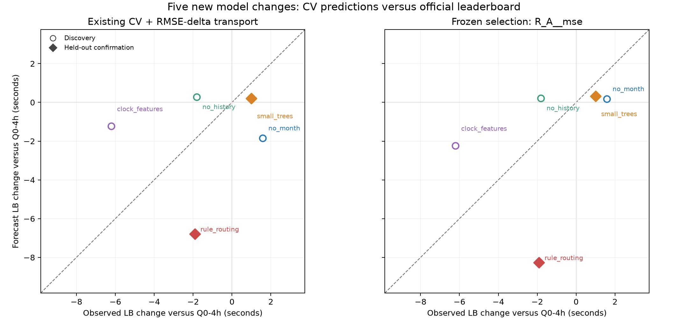

# Five new submissions and prospective CV assessment — 17 September 2026

**No reliably better CV was established; more varied submissions are needed.**

The frozen R_A__mse forecast policy changed held-out change-prediction MAE by +0.68 seconds versus R_combined (negative is better). It did not improve prediction of the held-out changes, so the prospective comparison does not support replacing the current CV.

Two held-out recipes on the same competition population cannot establish performance on another year or broad modelling changes. Keep the current default CV unchanged while collecting further varied submissions. No fold was dropped and no validation default was changed. A calibrated leaderboard forecast is distinct from the raw CV score.

All five authorized uploads succeeded. The best new model is **clock_features / v19: 338.1113 seconds**, an improvement of **6.2001 seconds** over Q0-4h/v15. This is meaningful model progress; it does not validate a replacement CV.

## What was tested

Five distinct interventions were trained, validated and submitted. All use the fixed four-hour Rome rule, recovery off, direct regression, 800 rounds and full evaluation populations. Local validation uses seeds 42/142/242; submissions use seed 42 and all twelve 2025 months. The local control is Q0-4h; its already-scored official reference is 344.3114 seconds. Negative changes mean improvement.

| Recipe | Change | Evidence role | Submission |
|---|---|---|---|
| no_month | Calendar extrapolation may transfer differently in chronological CV and 2026. | discovery | unique-rose_v17.parquet |
| no_history | Removing stale departure-label summaries may reduce temporal transfer error. | discovery | unique-rose_v18.parquet |
| clock_features | Observable clock disagreements may improve ordinary predictions. | discovery | unique-rose_v19.parquet |
| small_trees | Lower model capacity may generalize differently from the 255-leaf control. | confirmation | unique-rose_v20.parquet |
| rule_routing | Removing rule-handled training rows may improve the remaining predictions. | confirmation | unique-rose_v21.parquet |

Original CV retains all sixteen folds across six chronological origins. Seasonal validation uses the ten-month joint January/July holdout and two eleven-month single-month holdouts. The common feature matrix is scoped to each training window; evaluated departures never supply departure labels to training. Rule routing removes eligible rows only from model fitting, preserving history context and every evaluation row.

## All ten official scores and local CV levels

CV entries below average squared errors across three seeds. Repeated origins first average losses on the same flights. These are local scores, not averages of the submitted seed-42 predictions. Historical rows retain their original historical scores; the new rows use this execution.

| Recipe | Submission | LB | Original v3 | Month balanced | Seasonal 10m | Seasonal 11m |
|---|---|---|---|---|---|---|
| B0-800 | unique-rose_v12.parquet | 406.4281 | 348.9770 | 368.4560 | 472.1432 | 468.6279 |
| Q0 | unique-rose_v13.parquet | 354.4303 | 276.7374 | 300.6530 | 384.6688 | 386.5293 |
| Q1 | unique-rose_v14.parquet | 354.0004 | 276.1937 | 296.7793 | 375.3239 | 376.0824 |
| Q0-4h | unique-rose_v15.parquet | 344.3114 | 274.3707 | 297.0242 | 379.0118 | 377.6050 |
| Q1-4h | unique-rose_v16.parquet | 344.4821 | 273.7215 | 293.6947 | 373.5772 | 373.4523 |
| no_month | unique-rose_v17.parquet | 345.8984 | 272.5082 | 296.6403 | 380.4677 | 378.0763 |
| no_history | unique-rose_v18.parquet | 342.5049 | 274.6319 | 297.2956 | 378.4996 | 376.1919 |
| clock_features | unique-rose_v19.parquet | 338.1113 | 273.1284 | 294.7321 | 374.3450 | 370.7952 |
| small_trees | unique-rose_v20.parquet | 345.3113 | 274.5645 | 297.1049 | 380.2407 | 379.0468 |
| rule_routing | unique-rose_v21.parquet | 342.4009 | 267.5759 | 287.4159 | 368.1369 | 368.3539 |

The regenerated local control scores are R_combined 274.3622, month_balanced 297.0224, seasonal_10m 379.0118, seasonal_11m 377.6050. It was not submitted again. New candidate deltas subtract this matched execution control; historical deltas subtract historical Q0-4h. This avoids attributing host or replay differences to the candidate intervention.

The seed-42 full-year control was also replayed and compared, after submission rounding, with the historical **unique-rose_v15.parquet** prediction artifact. This uses prediction vectors only; hidden leaderboard labels were not accessed.

| Control replay measure | Value |
|---|---|
| Ranking rows compared | 344841 |
| Exactly matching rounded predictions | 342144 |
| RMSE between prediction vectors, seconds | 0.251915 |
| Mean absolute prediction change, seconds | 0.018194 |
| Maximum absolute prediction change, seconds | 25.000000 |

By the triangle inequality, the RMSE between two prediction vectors bounds the absolute difference between their leaderboard RMSEs against any fixed target vector. The control replay therefore bounds possible host/replay score drift at **0.251915 seconds**, without knowing the hidden labels. It does not identify the sign of any drift or quantify 2025-to-2026 population shift. [Replay audit and full hashes](overnight_20260917/control_replay_final.json).

## Changes versus the matched control

Intervals are paired calendar-day bootstrap intervals on 2025 validation losses, conditional on the fitted seeds and origins. They do not estimate hidden-2026 leaderboard uncertainty.

| Recipe | Official LB Δ | Original v3 Δ [95% interval] | R_A raw CV Δ [95% interval] |
|---|---|---|---|
| no_month | +1.59 | -1.85 [-3.08, -0.76] | +0.20 [-0.15, +0.56] |
| no_history | -1.81 | +0.27 [-0.13, +0.66] | +0.24 [-0.36, +0.82] |
| clock_features | -6.20 | -1.23 [-3.84, +1.34] | -2.61 [-6.63, +1.02] |
| small_trees | +1.00 | +0.20 [-0.21, +0.60] | +0.37 [-0.14, +0.85] |
| rule_routing | -1.91 | -6.79 [-9.39, -4.38] | -9.64 [-14.02, -5.48] |

These intervals apply to raw local score changes. They are not uncertainty intervals for the calibrated leaderboard forecasts, including MSE-delta transport.

## What the additional submissions taught us

**The extra variety was useful, but five submissions did not establish a reliably better CV.** Removing month looked beneficial under the original combined CV and regressed on LB. Removing history had an inconclusive small local regression but improved on LB. Clock features improved LB much more than the original CV suggested. Training-row routing did improve LB, but by much less than every tested CV summary suggested.

The frozen alternative used **R_A: the six next-month folds**, with squared-error-change calibration to the known LB baseline. It forecasts the smaller-tree result slightly more accurately, but overstates the routing improvement more than the current method does. A calibration can bring score levels closer without making model choices more reliable.

About **93.3%** of the selected policy's calibration error reduction comes from fitting the single historical B0-800 outcome more closely. Removing that observation changes the selected policy to **seasonal_11m**. This concentration helps explain why the calibration improvement was not broad evidence of better prediction of new interventions.

| Forecast policy | Three feature changes: change MAE | Four historical rule/recovery changes: change MAE | Two confirmation changes: change MAE |
|---|---|---|---|
| R_combined | 3.4945 | 7.2319 | 2.8367 |
| R_A__mse | 2.4622 | 4.6883 | 3.5178 |
| seasonal_11m | 0.7063 | 11.4090 | 3.8913 |
| blend_25__mse | 0.6962 | 11.1745 | 3.9921 |

This table is a descriptive family comparison, not a new selection. Seasonal eleven-month validation tracks the three feature changes much better than the original CV, while the historical rule/recovery changes favor other summaries. When the entire historical family is left out of calibration, the winner becomes **blend_25__mse**, a fixed blend with 25% month-balanced and 75% seasonal-eleven-month MSE, followed by MSE-change transport. Its apparent advantage does not transfer to the omitted historical family or the two confirmation cases. The best summary depends on which kinds of model changes we show it.

**All 20 tested forecast policies choose rule_routing over clock_features across the ten candidates.** On LB, clock_features is better by **4.2896 seconds**. Even choosing a different policy after seeing confirmation would not fix this practical model-selection failure. These are related readouts of the same data, not twenty independent experiments.

The confirmation was also weakly discriminating: smaller trees changed LB by only +0.9999 seconds, within the one-second tolerance. The selected and original forecasts differ so little on these two cases that the largest mathematically possible MAE advantage was only 0.7939 seconds, regardless of their eventual scores. The report uses a conservative greater-than-one-second gain gate when labelling limited progress; the original design specified improved confirmation predictions and a one-second tolerance, without an explicit greater-than-one-second MAE clause. Here the selected policy actually worsened MAE, so the negative verdict does not depend on that stricter reporting gate.

### How this connects to the earlier validation work

The earlier [seasonal comparison](../runs/seasonal_jan_jul/comparison.md) found closer absolute levels but poorer change-size alignment on the five rule/recovery submissions. The [fold audit](FOLD_ALIGNMENT.md) found no defensible harmful-fold removal. The [optimism diagnosis](VALIDATION_OPTIMISM.md) identified a concrete population mismatch: November/December receive 69.17% of the original headline MSE weight, July receives little weight, and January is absent. Rare January errors can also make seasonal scores pessimistic. The [month-balanced proposal](AGGREGATION_COMPARISON.md) changes those weights, but this larger study still provides no confirmed replacement. The additional outcomes show why closeness on one model family was insufficient evidence.

### Recommended next evidence

Keep the current CV as the operational reference and inspect next-month, longer-gap and seasonal diagnostics alongside it. Treat disagreements as uncertainty; do not fit free fold weights to these ten scores or remove difficult evaluation rows. The next submission batch should include different model/loss or training-population approaches, not only more variants of the same rule. All five new models here still use LightGBM squared-error regression and the same four-hour rule.

Before seeing new outcomes, freeze a small number of CV alternatives and reserve confirmation candidates whose predictions differ enough to distinguish those alternatives. Test across intervention families, with more than two confirmation cases. There is no defensible fixed number of additional submissions that guarantees success; another five would be additional evidence, not a promised solution. No further uploads were made or scheduled. This batch made progress in diagnosing CV limitations, not in establishing a reliably better CV.

### Amendment before any new leaderboard outcome

The forecast-policy amendment was recorded at **2026-09-17T03:32:15.447465+00:00**, after training had started but **before the first new upload or any new leaderboard outcome**. It added fixed MSE-delta transport alongside the original RMSE-delta transport for the same ten CV summaries. It changed neither the five models/submission queue nor the primary selection criterion. The original preregistration remains unchanged and is bound into the amendment by SHA256. This was an amendment during execution, not part of the initial preregistration. [Amendment rationale and formulas](../docs/OVERNIGHT_STUDY_20260917_AMENDMENT1.md); [Amendment identity and timing](overnight_20260917/amendment1.json).

## Discovery selection, frozen before confirmation

The five historical submissions plus the first three new submissions formed the calibration set. Selection compared seven non-anchor candidate changes. Ten fixed CV summaries were considered, each with RMSE-delta and MSE-delta transfer assumptions, giving twenty fixed forecast policies; there was no arbitrary fold-subset or free-weight search. The unchanged original readout wins when it is within one second of the lowest calibration change-error MAE.

RMSE-delta transport assumes that the local RMSE change transfers: `forecast = L0 + (Rc − R0)`. MSE-delta transport instead assumes that the local squared-error change transfers: `forecast = sqrt(L0² + Rc² − R0²)`, provided the radicand is nonnegative (an invalid negative radicand is rejected). Here `L0` is the known Q0-4h LB, `Rc` the candidate CV score and `R0` its matched control CV score. Neither assumption changes training, fold weights or the underlying raw CV scores.

Frozen selection: **R_A__mse**; underlying readout **R_A**, calibration **mse_delta**, at **2026-09-17T04:16:21.988319+00:00**. The two confirmation outcomes were authorized for reading at **2026-09-17T04:18:11+00:00**.

| Forecast policy | Anchored change MAE | Raw level MAE | Misorderings | Missed separations | False separations | Selection regret |
|---|---|---|---|---|---|---|
| R_combined | 5.6301 | 69.9873 | 3 | 4 | 0 | 7.7871 |
| R_A | 4.8312 | 48.7661 | 1 | 7 | 2 | 6.3708 |
| R_B_long | 6.8735 | 88.0949 | 5 | 6 | 2 | 7.7871 |
| month_balanced | 5.3140 | 48.1115 | 2 | 6 | 2 | 6.3708 |
| unique_flight | 5.3591 | 46.1104 | 2 | 6 | 2 | 6.3708 |
| seasonal_10m | 8.2025 | 35.9838 | 4 | 3 | 2 | 6.3708 |
| seasonal_11m | 6.8221 | 34.6492 | 3 | 2 | 2 | 0.0000 |
| blend_25 | 6.3186 | 15.7020 | 3 | 2 | 2 | 0.0000 |
| blend_50 | 5.9849 | 8.0464 | 2 | 5 | 2 | 0.0000 |
| blend_75 | 5.6488 | 25.4584 | 1 | 7 | 2 | 0.0000 |
| R_combined__mse | 3.9445 | 69.9873 | 2 | 6 | 0 | 7.7871 |
| R_A__mse | 3.7343 | 48.7661 | 1 | 7 | 2 | 6.3708 |
| R_B_long__mse | 4.4857 | 88.0949 | 4 | 8 | 2 | 7.7871 |
| month_balanced__mse | 4.1739 | 48.1115 | 1 | 7 | 2 | 6.3708 |
| unique_flight__mse | 4.2630 | 46.1104 | 2 | 6 | 2 | 6.3708 |
| seasonal_10m__mse | 9.2102 | 35.9838 | 4 | 2 | 2 | 6.3708 |
| seasonal_11m__mse | 7.8379 | 34.6492 | 3 | 2 | 2 | 0.0000 |
| blend_25__mse | 6.6838 | 15.7020 | 3 | 2 | 2 | 0.0000 |
| blend_50__mse | 5.8725 | 8.0464 | 2 | 5 | 2 | 0.0000 |
| blend_75__mse | 5.0364 | 25.4584 | 1 | 7 | 2 | 0.0000 |

Dropping one calibration candidate at a time selected: R_A__mse in 4/7 cases, R_combined__mse in 2/7 cases, seasonal_11m in 1/7 cases. This measures sensitivity on the same calibration observations and is not independent confirmation.

## Held-out confirmation

Only the frozen choice versus unchanged R_combined is confirmatory. Other summaries remain descriptive after these outcomes are revealed. Forecasts use the known Q0-4h LB and their frozen RMSE-delta or MSE-delta transfer assumption; they are not raw CV scores.

| Recipe | Actual LB | Frozen selected forecast | Original-v3 forecast | Selected forecast error | Original forecast error |
|---|---|---|---|---|---|
| small_trees | 345.3113 | 344.6264 | 344.5137 | -0.6849 | -0.7976 |
| rule_routing | 342.4009 | 336.0501 | 337.5251 | -6.3508 | -4.8758 |

| Forecast policy | Anchored change/level MAE | Raw level MAE | Frozen offset level MAE | Misorderings | Missed separations | Selection regret | Worst near-tie regret |
|---|---|---|---|---|---|---|---|
| R_combined | 2.8367 | 72.7859 | 2.4352 | 0 | 0 | 0.0000 | 0.0000 |
| R_A__mse | 3.5178 | 52.2227 | 3.5491 | 0 | 0 | 0.0000 | 0.0000 |

The selected-minus-original held-out change MAE is **+0.6812 seconds**. A negative value favors the selected forecast policy. Improvement in both individual absolute forecast errors: **False**. New material ordering/near-tie mistakes: **0**.

Raw score closeness and change prediction answer different questions. The additive offset is the calibration-set median of LB minus raw CV, frozen before confirmation; improved offset forecasts alone do not establish better candidate ranking.

| Recipe | Forecast policy | Raw CV | LB − raw CV | LB − anchored forecast | LB − frozen-offset forecast |
|---|---|---|---|---|---|
| no_month | R_combined | 272.5082 | +73.3902 | +3.4410 | +3.0396 |
| no_month | R_A__mse | 296.4686 | +49.4298 | +1.4175 | +0.6984 |
| no_history | R_combined | 274.6319 | +67.8730 | -2.0762 | -2.4777 |
| no_history | R_A__mse | 296.5108 | +45.9941 | -2.0123 | -2.7373 |
| clock_features | R_combined | 273.1284 | +64.9829 | -4.9663 | -5.3677 |
| clock_features | R_A__mse | 293.6614 | +44.4499 | -3.9567 | -4.2815 |
| small_trees | R_combined | 274.5645 | +70.7468 | +0.7976 | +0.3961 |
| small_trees | R_A__mse | 296.6377 | +48.6736 | +0.6849 | -0.0578 |
| rule_routing | R_combined | 267.5759 | +74.8250 | +4.8758 | +4.4743 |
| rule_routing | R_A__mse | 286.6291 | +55.7718 | +6.3508 | +7.0405 |

### Seed-42 diagnostic

This matches the submission seed but did not select the validation readout. Each old candidate uses its old seed-42 anchor; each new candidate uses the regenerated seed-42 control, under the same fixed transfer assumption.

| Forecast policy | Held-out change MAE | Raw level MAE | Misorderings | Missed separations | Selection regret |
|---|---|---|---|---|---|
| R_combined | 3.1319 | 72.8879 | 0 | 0 | 0.0000 |
| R_A__mse | 3.5625 | 52.1636 | 0 | 0 | 0.0000 |

### Candidate ranking across all observed submissions

These comparisons use all ten results and are descriptive. The many overlapping pairs are dependent; they are not additional independent confirmation trials. A material LB difference paired with a local difference of at most one second counts as a missed separation.

| Forecast policy | Agreements | Misorderings | Missed separations | False separations | CV winner | Selection regret |
|---|---|---|---|---|---|---|
| R_combined | 30 | 4 | 5 | 2 | rule_routing | 4.2896 |
| R_A__mse | 28 | 2 | 9 | 4 | rule_routing | 4.2896 |



[Standalone PDF](OVERNIGHT_SUMMARY_20260917.pdf). Hollow circles are discovery recipes; filled diamonds are the two held-out recipes. No prediction bands or hidden-label uncertainty estimates are implied.

## Execution, reuse and upload audit

| Execution measure | Recorded value |
|---|---|
| New validation fits | 153 |
| Imported completed seasonal-control fits | 9 |
| Total validation model/seed/origin combinations | 162 |
| Validation prediction files | 360 |
| Completed full-year refits / ranking outputs | 6 / 6 |
| New validation fit minutes, summed | 84.38 |
| Full-year refit minutes, summed | 4.44 |
| Recorded runner wall time through last update, minutes | 132.78 |
| Fit threads / prediction threads / simultaneous fits | 8 / 8 / 1 |

Fit-minute totals include each model save/provenance step and exclude shared feature preparation and prediction work. Imported fits contribute zero new fit minutes. Runner wall time may include any gap between validation and refit commands. All model/prediction/source-snapshot artifacts remain local and ignored; concise records and analysis source are retained.

Verification: **101 tests passed** at 2026-09-17T03:35:29.173937+00:00; the complete suite took 16.769 seconds. The execution-only smoke run covered all six recipes and nine windows (54 tiny fits and 120 prediction files). Smoke scores were never used to rank models. [Recorded checks](overnight_20260917/checks.json).

| File | Recipe | Role | Upload UTC | Score read UTC | Status | LB | SHA256 prefix |
|---|---|---|---|---|---|---|---|
| unique-rose_v17.parquet | no_month | discovery | 2026-09-17T04:11:53+00:00 | 2026-09-17T04:13:37+00:00 | Succeeded | 345.8984 | 195a1eac2f49ad93 |
| unique-rose_v18.parquet | no_history | discovery | 2026-09-17T04:11:55+00:00 | 2026-09-17T04:13:39+00:00 | Succeeded | 342.5049 | 0915233af837212d |
| unique-rose_v19.parquet | clock_features | discovery | 2026-09-17T04:11:59+00:00 | 2026-09-17T04:13:41+00:00 | Succeeded | 338.1113 | 5678c8e7c811da97 |
| unique-rose_v20.parquet | small_trees | confirmation | 2026-09-17T04:12:02+00:00 | 2026-09-17T04:18:12+00:00 | Succeeded | 345.3113 | 8b80b2859ec6cb9a |
| unique-rose_v21.parquet | rule_routing | confirmation | 2026-09-17T04:12:05+00:00 | 2026-09-17T04:18:13+00:00 | Succeeded | 342.4009 | 484df1c9aefb7800 |

All five submitted artifacts retain the original template IDs/order/schema, have 344,841 scored pairs, and were verified against remote bytes. The submission manifest retains full hashes, quota checks and raw official result payloads.

| Chronology checkpoint | Timestamp |
|---|---|
| Study preregistration | 2026-09-17T01:52:08.184589+00:00 |
| Validation runner start | 2026-09-17T01:55:59+00:00 |
| Forecast-policy amendment before any new upload | 2026-09-17T03:32:15.447465+00:00 |
| CV selection freeze | 2026-09-17T04:16:21.988319+00:00 |
| Confirmation reveal authorization | 2026-09-17T04:18:11+00:00 |
| Confirmation evaluation | 2026-09-17T04:19:38.844797+00:00 |

The confirmation reveal seal matches the final frozen-selection SHA256, and the generator verified that every discovery score was recorded before the freeze and each confirmation score after reveal authorization. No additional upload or automatic daily-reset retry is part of this five-submission study.

## Best, latest and reproducibility

Best among these ten scored candidates: **unique-rose_v19.parquet, 338.1113 seconds**. Latest in this batch: **unique-rose_v21.parquet, 342.4009 seconds**.

Before-run live snapshot: 2026-09-17T01:41:48+00:00; team best unique-rose_v15.parquet at 344.3114 seconds.

Final live snapshot: 2026-09-17T04:23:02+00:00; team best **unique-rose_v19.parquet, 338.1113 seconds**; latest **unique-rose_v21.parquet, 342.4009 seconds**; rank **94/152** scoring teams.

Runtime: AMD Ryzen 7 7800X3D 8-Core Processor; Python 3.12.3; duckdb 1.5.5, lightgbm 4.7.0, numpy 2.5.2, pandas 3.0.5.

[Prespecified design](../docs/OVERNIGHT_STUDY_20260917.md)
[Prerecording and plan hash](overnight_20260917/preregistration.json)
[Pre-outcome forecast-policy amendment](../docs/OVERNIGHT_STUDY_20260917_AMENDMENT1.md)
[Amendment hash and timing](overnight_20260917/amendment1.json)
[Frozen source/data/runtime/config record](../runs/overnight_20260917/result.json)
[Five-upload manifest and full hashes](../runs/overnight_20260917/submission_manifest.json)
[Every fold, seed, population and interval](../runs/overnight_20260917/cv_scores.json)
[Immutable discovery selection and forecasts](../runs/overnight_20260917/cv_selection_frozen.json)
[Held-out result and dependent all-pair diagnostics](../runs/overnight_20260917/confirmation_report.json)
[Offline report generator](../tools/summarize_overnight_study.py)

Report input hashes:

| Artifact | SHA256 |
|---|---|
| result.json | 4c7892bf59941594b99448b6e667dd3341a3c5cb52bf2edf5122b9e3d97be49e |
| progress.json | ed37ada2873d01cc1b841d0f85b0263ab768c95841bf92f79b6d2d855b4cfd08 |
| submission_manifest.json | 89f17b9f09d4d520526d74bbecb30a3bde26d9b2b483c38e38926316028cdcf5 |
| cv_scores.json | cd71e25bacbaf5d75ca1b0f2a8867c65b3bc6c5ec362c7bdfd1127bd6b18a0ac |
| cv_selection_frozen.json | 837a815122e268a212f5efb2952c1902889c129cd492112bdec3f8e594fcaed2 |
| confirmation_report.json | 9c8fdb67214fc60d66bf52e066f6dfc24b3575350191bf08c3163ea30854e7e1 |
| discovery_scores.json | 267dbe58d17061c9f0b08899249df82410e73cda25a6676f5028072a16577432 |
| confirmation_scores.json | 47794d2b7f61a6ae11a7088c8c1dd732c3d67af79c4949a0ae0ffd17064fea8f |
| preregistration.json | a8a9afd9c7c2c7b0fe87efa1488ab61a2856996bb19c4063ce315c35eb4f2c80 |
| status_before.json | 09915594e0f51ab3f32e6e6bca13b64527b3c72fd715538423e1182fc6c3f8a0 |
| amendment1.json | a53d14d2b985af66eb6095e8255c2401ddb6a3b00db73edf73bd3211feed0501 |
| amendment1_document.md | 94ffbe612108d7a419fc7758cd6dd1c71cf5dab711d33a46dde25c36c514a504 |
| status_after.json | be8a3180711be18a554bb5a9900cb5ac102f15ede46f5594d192208d88285c69 |
| checks.json | 193e10f493db97f59afe01a4ad416aac315c9ceddad9e95f95b5bb92eab955da |
| control_replay_final.json | 7955225a7d5121f2cd84bf3e1a8ef652d9cb6021c9c1eba386516ff7bbc226a9 |

Reproduce after all five official scores and sealed confirmation are complete:

```bash
.venv/bin/python VALIDATION/tools/summarize_overnight_study.py
```
