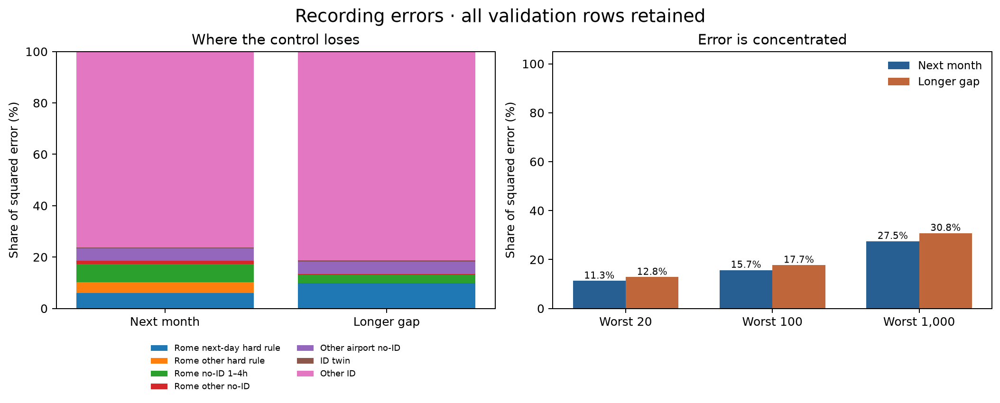
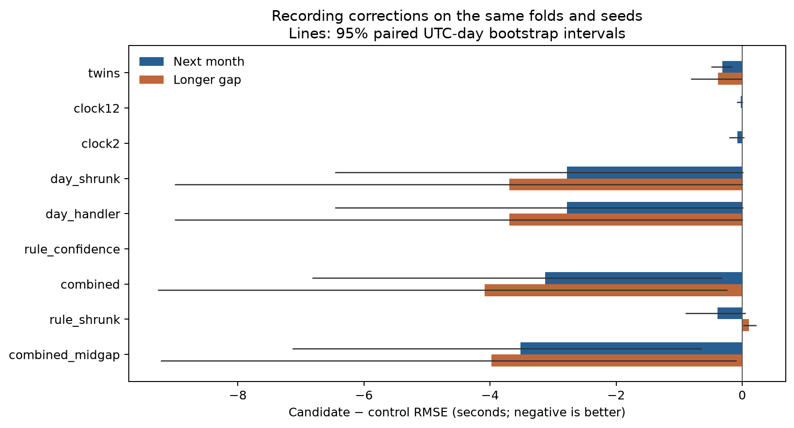

# Recording-artifact experiments — 19 September 2026

**Archived exploratory results; no experiment is promoted or independently
confirmed.** The study's entries were removed from `SUBMISSIONS.md`; former row
numbers 37–46 are historical study identifiers only. The measurements below
are retained for reproducibility, not as a submission recommendation.

Rome's largest errors come from several different recording patterns. Some
labels use the scheduled departure as off-block. Others include an extra day.
Some flights have ordinary taxi times despite triggering the four-hour rule.

Ranking targets are hidden. We can identify suspicious ranking features, but
cannot measure their errors. No submission or full-year fit is part of this
study. The [frozen design](../docs/RECORDING_ARTIFACT_EXPERIMENTS.md) records all
nine candidates and the amendments made before candidate scoring.

The control is row 34: stand model, flight-plan window and no-ID cap. Its model
and prediction files were missing on this laptop. The
[local replay](../runs/v3_20260919_artifact_control/result.json) completed
36 booster fits in 31.412 minutes: six training windows, three seeds, sixteen
folds. Movement and METAR hashes match history. Its combined RMSE is 239.9468 s,
only 0.0070 s above historical row 34. New experiments use this local control;
historical scores stay unchanged. No historical ablation was rerun.

## What the clocks mean

| Actual feature | Meaning and use |
|---|---|
| `MVT_TIME_UTC_mvt` | Recorded takeoff time. |
| `SCHED_TIME_UTC_mvt` | Scheduled departure. Their difference is the schedule gap. |
| `FLIGHT_ID_mvt` | Link to a flight plan. Missing IDs often accompany recording problems. |
| `LOBT_flt` | Last known off-block time. Recorded taxi time stays within takeoff−LOBT ±61 minutes on all matched 2025 departures. |
| `AOBT_3_flt` | Actual off-block in the flown plan. Useful as another clock, but sometimes wrong. |
| `FLIGHT_mvt`, `STAND_mvt` | Flight number and stand. Two nearby takeoffs with the same flight number can be duplicate tow records. |
| `handler_arr_sched_share`, `handler_arr_n` | Share and count of an airline's arrivals whose recorded in-block matches schedule. These use arrival information available in ranking. |

Every training label equals recorded takeoff minus recorded off-block. Some
timestamps describe recording mistakes rather than physical taxi time.

## Patterns behind the experiments

The [raw audit](recording_artifacts_20260919/RAW_PATTERN_FINDINGS.md) covers
2,085,047 training departures, 1,079,528 unique July–December CV departures,
and 344,841 ranking departures. CV counts here do not repeat flights across
folds or seeds.

**Extra-day Rome records.** Among twenty no-ID training departures with schedule
gaps of at least fourteen hours, eleven labels are one day plus ordinary taxi;
nine are schedule substitutions. Eight of fourteen CV cases have the day-shift
shape. Six ranking rows have this large gap; five cross a Rome-local date.
Local dates matter: a September takeoff at 22:38 UTC crosses midnight in Rome,
although its schedule is on the same UTC date. Its label is 87,543 seconds.

**Ordinary taxis caught by the Rome rule.** Fifteen training flights satisfy the
four-hour rule but have labels of only 723–1,681 seconds. Eleven enter CV.
Their schedule gaps are 4.07–6.40 hours. A hard override gives these flights
hours of taxi time.

**A nearly day-long flight-plan gap.** One training flight and one ranking
flight have a flight ID and takeoff−LOBT above twelve hours. The training label
is 87,002 seconds; takeoff−LOBT is 87,001. The ranking flight's v34 prediction
is already 83,160 seconds after the plan-window correction. Its two plan-clock
estimates are 86,340 and 86,820. Only a few thousand seconds remain to adjust.

**Duplicate takeoffs.** Training has 102 two-record clusters with exactly one
flight ID; ranking has sixteen. At LFPG these often represent different stands
and very different recorded off-block times. The existing twin correction
addresses the linked record. Its combination with row 34 needs validation.

## Nine fixed candidates

Each single change starts from row 34. Learned offsets and weights use only
that fold's training window. Blends shrink toward the existing rule.

| Candidate | Change |
|---|---|
| `twins` | Add the existing duplicate fix: takeoff−LOBT−330 seconds for the linked record. |
| `clock12` | When both plan-clock gaps are at least twelve hours and agree within thirty minutes, use takeoff−AOBT3 plus a strongly shrunk training offset; retain the LOBT window. |
| `clock2` | The same experiment from two hours. Broader clock agreement has weak training support, so this is exploratory. |
| `day_shrunk` | Blend the schedule gap with 86,400 seconds plus the training mean ordinary taxi for qualifying next-day Rome rows. |
| `day_handler` | Allow different day-blend weights by arrival schedule share, only with enough observations and five training dates in both groups. |
| `rule_confidence` | In the four-to-twelve-hour Rome band, replace the hard rule only when the existing classifier's schedule-substitution probability is below 0.05. |
| `combined` | Primary combination: twins + handler day blend + confidence exception + twelve-hour clock correction. |
| `rule_shrunk` | Fit one conservative blend between the hard rule and ordinary taxi in the four-to-twelve-hour band. |
| `combined_midgap` | Replace the confidence exception in `combined` with `rule_shrunk`. |

The last two were added before scoring: the raw audit showed ordinary false
positives, while an A1 execution check found no rows passing the 0.05 gate.
This re-tests a narrow form of rule softening; it is not independent confirmation.
The freeze concerns **candidate scores**. An A1 control-reproduction score and
feature coverage were checked beforehand; the module's introductory wording
about unseen control scores is too broad. The amendment history above and in
the frozen design records the actual sequence.

## Validation results

`combined` has lower development errors in both horizons and all three seeds.
`combined_midgap` has the lowest combined point estimate, but its extra calibration
worsens the longer-gap score. The earlier recommendation of `combined` is withdrawn:
these reused development data informed the hypotheses, and neither seed agreement
nor bootstrap intervals remove adaptive selection bias. Neither has been submitted.

| Candidate | Next month | Longer gap | Combined | Combined change [95% interval] |
|---|---:|---:|---:|---|
| Local row-34 control | 253.0698 | 228.9793 | 239.9468 | — |
| twins | 252.7511 | 228.5943 | 239.5932 | -0.3536 [-0.6301, -0.1103] |
| clock12 | 253.0453 | 228.9793 | 239.9353 | -0.0115 [-0.0354, +0.0000] |
| clock2 | 252.9959 | 228.9793 | 239.9122 | -0.0345 [-0.0935, +0.0122] |
| day_shrunk | 250.2931 | 225.2825 | 236.6851 | -3.2616 [-7.4913, -0.0558] |
| day_handler | 250.2931 | 225.2825 | 236.6851 | -3.2616 [-7.4913, -0.0558] |
| rule_confidence | 253.0698 | 228.9793 | 239.9468 | +0.0000 [+0.0000, +0.0000] |
| combined | 249.9460 | 224.8911 | 236.3151 | -3.6317 [-7.8338, -0.4389] |
| rule_shrunk | 252.6808 | 229.0860 | 239.8219 | -0.1248 [-0.3649, +0.0991] |
| combined_midgap | 249.5521 | 224.9998 | 236.1883 | -3.7585 [-7.9243, -0.5616] |

All values are RMSE in seconds. Intervals use 2,000 paired UTC-day bootstrap draws. These are pointwise development comparisons, not untouched confirmation. No row or fold was removed. The [complete run](../runs/v3_20260919_artifact_experiments/result.json) retains exact metrics; these experiments have no active submission-list entries.

The combined correction changes 67 unique flights on 55 dates. The day blend changes 13 flights on 12 dates; the clock anchor changes one flight. The twin correction changes 53 flights. Repeated fold/seed appearances are not independent examples. Handler weights fall back in all six training windows, so its result exactly matches the pooled day blend. The confidence exception changes zero rows. These last two findings do not represent additional useful models. The 0.0115-second clock difference on one flight is inconclusive and does not demonstrate practical value.

The combined change has a three-day interval of −3.6317 s [−7.3249, −0.3560]. Both individual horizons also exclude zero in this pointwise calculation; this is not independent confirmation. The day blend alone is less certain: its one-day combined interval barely excludes zero, while the two individual horizons include zero. The clock experiments are inconclusive.

`rule_shrunk` alone worsens longer-gap RMSE by +0.1067 s [+0.0224, +0.2166]. It helps some ordinary taxi labels caught by the rule, but also lowers correctly recorded schedule-gap labels. The resulting combined improvement is inconclusive. Adding it to `combined` buys only 0.1268 s in the provisional combined score and worsens longer-gap RMSE by 0.1087 s.

The combined correction reduces tail RMSE (>7,200 s labels) from 4,638.3 to 4,121.4 s next-month, and 5,898.3 to 5,048.8 s longer-gap. These groups contain only 348 and 61 unique flights. Ordinary-label RMSE improves by 0.2341 and 0.2941 s. LFPG and LIRF improve; the other eight airports are unchanged.

The worst twenty unique flights account for **11.27% / 12.81%** of control
squared error (next-month / longer-gap). The combined correction lowers these
shares to **8.90% / 9.93%**. The next-day Rome cohort alone has thirteen/three
flights but contributes 5.97%/9.83% of control error. Most total error still
comes from the large other-ID population: 76.32%/81.19%.

| Real CV example | Recorded target | Control → combined prediction | What it shows |
|---|---:|---:|---|
| ITYTY630, Rome, 28 Sep | 87,543 | 50,581 → 60,935 | A day-sized label. The correction reduces error from 36,962 to 26,608 s. |
| QFAQFA6, Rome, 7 Sep | 53,410 | 53,405 → 62,968 | A correct schedule-gap label. The day blend creates a 9,558 s error. |
| NOS430, Rome, 28 Aug | 1,078 | 23,039 → 23,039 | Ordinary taxi caught by the hard rule. The combined correction leaves this unresolved. |
| WMT8PV, Rome, 2 Aug | 25,018 | 3,573 → 3,573 | Schedule gap is only 1,679 s. Visible clocks do not supply a reliable correction. |

Predictions above are rounded descriptive means. Scores average squared errors
across seeds and repeated training origins. The combined model helps 53 and
harms fourteen unique next-month flights. Its most influential day is 4 November:
removing that date **only for diagnosis** leaves a combined change of −2.1660 s,
versus −3.6317 s with all rows. Next-month and longer-gap improvements also
remain negative after removing their individually most influential date.
All published scores keep those dates. See the
[full error diagnosis](recording_artifacts_20260919/ERROR_DIAGNOSTICS.md).

## Limits and leaderboard hypotheses

**Hypothesis: `clock12` may gain more on the leaderboard than in CV.** Its one
ranking case is 3.13 times as prevalent per flight as its one unique CV case.
The hidden target is unknown, and row 33 already fixed most of the suspected
error. Applying each saved CV-window coefficient set to the scored v34 file
moves this prediction from 83,160 to 86,132–86,440 s. The largest possible
improvement across those settings is only **0.1927 leaderboard seconds**, even
assuming the hidden label obeys the empirical LOBT ±61-minute window and is
compatible with the known total error. This conditional bound is not a forecast.

**Conditional larger-gain scenario for the day blend.** Five ranking flights
qualify, including one in January, which current CV never evaluates. If all
five hidden labels equal a day plus the fitted ordinary taxi mean, the isolated
day correction would improve v34 by 5.015–9.079 s across the six coefficient
sets, more than its 3.2616 s CV gain. If their labels instead equal the schedule
gap, it would worsen v34 by 0.490–1.930 s. These are hypothetical endpoints,
not a forecast of the unknown label mixture. The training pattern is too sparse
to establish which case transfers. Exact assumptions and examples are in the
[ranking sensitivity](recording_artifacts_20260919/ranking_sensitivity.md).

No broad schedule correction is justified outside Rome: none of 413 no-ID
training flights at least four hours late matches the schedule gap. EHAM has
148 such ranking flights versus 53 unique CV flights, an 8.7-fold prevalence
increase, but v34 predictions are already ordinary-sized.

Six training no-ID flights have labels above four hours despite schedule gaps
below two hours. Only one enters current CV. One resembles a one-day shift,
but no reliable visible rule separates these six from ordinary flights.
No universal DST correction or new duplicate rule emerged.

The existing day-shift mixture was previously inconclusive. These reused
development folds contain no January, and a few flights can dominate RMSE.
Report sparse-case influence and uncertainty; preserve every evaluation row.

## Execution and reproducibility

The control replay took 31.412 minutes. Deriving nine corrections and computing
all fourteen comparisons took 18.856 minutes, with zero additional boosters,
zero full-year fits and zero uploads. Each of the six calibration parameter
sets and all 48 prediction files are retained. Source, data and saved-artifact
hashes guard resumption. Models, predictions and source snapshots remain local
and gitignored; concise JSON results and figures are tracked.

The full 187-test validation suite passed. A subsequent projection-only guard
added two checks; all nine projection tests passed after that change. Two stale
legacy mixture tests were updated to the current standalone component API;
production mixture code was unchanged.

Implementation: [control replay](../artifact_control_run.py),
[correction models](../recording_artifacts.py),
[derived validation](../artifact_experiments_run.py),
[error diagnostics](../tools/summarize_artifact_errors.py) and
[ranking sensitivity](../tools/project_artifact_ranking.py).
The ranking tool reads the already-scored v34 file and explicitly excludes
departure labels and block timestamps. It reports sensitivity to six saved
CV-window parameter sets, not a fitted full-year recipe or a score forecast.
It covers the seven recipes independent of classifier probabilities. Full-year
classifier probabilities were unavailable, so `rule_confidence` and the original
`combined` were not projected onto ranking. Their inactive CV gate could still
activate there; the report does not assume otherwise.
