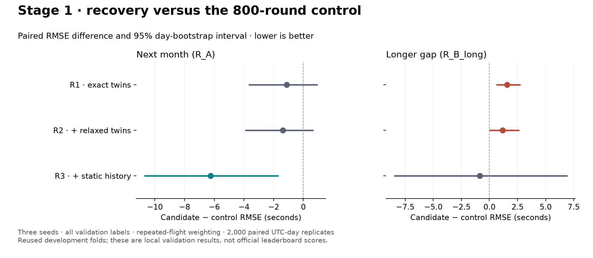

# Stage 1 — flight-plan recovery

**Complete. Select R3 provisionally for Stage 2; retain B0-800 as
the control.** R3 has a supported next-month gain and no supported regression
in the other main readout. Its longer-gap ordinary-flight regression remains
a material tradeoff. R1 and R2 alone are not promoted. No full-year refit or
submission was made.

| Candidate | R_A (seconds) | R_B_long (seconds) | R_combined (seconds) |
|---|---:|---:|---:|
| B0-800, recovery off | 366.7465 | 334.1785 | 348.9770 |
| R1, exact twins | 365.6176 | 335.7478 | 349.2914 |
| R2, plus relaxed twins | 365.3698 | 335.3479 | 348.9624 |
| R3, plus static history | **360.5041** | **333.3043** | **345.6144** |

The combined score is provisional. Selection uses R_A and R_B_long together,
with paired uncertainty and the slices below; these are reused development
folds, not official leaderboard results.

[Comparison data](stage1_comparison.json) · [Exportable figure](stage1_comparison.pdf).

## Controlled recipe

- Six-month windows, A1–A6/B1–B10, seeds 42/142/242, 800 fixed rounds.
- Training labels 1–200,000 seconds; every validation departure is scored.
- Original model features and parameters; `fpl_flag=False`.
- Sequential six-thread fitting and explicitly measured 20-thread inference.
- Recovery is the only feature-construction change across B0-800/R1/R2/R3.
- 2,000 paired UTC-day bootstrap replicates and the existing repeated-flight
  weighting; local development folds remain reused data.

The 1,500-round Stage 0 B0 remains unchanged. Its 800-round prediction files and
models were absent from this machine, so a separate local control was fitted.
Data hashes match Stage 0. The new control scored **R_A=366.7465 s** and
**R_B_long=334.1785 s**, within 0.03 s of the historical 800-round checkpoints.
All recovery comparisons use the new local control.

Control: [`v3_20260916T095948645262Z`](../runs/v3_20260916T095948645262Z/result.json).
R1: [`v3_20260916T102029635587Z`](../runs/v3_20260916T102029635587Z/result.json) (complete).

## R1 result and decision

| Readout | R1 RMSE | R1 − control | 95% paired interval | Decision |
|---|---:|---:|---|---|
| R_A | 365.6176 | −1.1289 | [−3.6378, +0.9182] | Inconclusive |
| R_B_long | 335.7478 | +1.5693 | [+0.6539, +2.6897] | Regression |

Do not promote R1. Keep B0-800 selected while evaluating the separately
registered R2/R3 extensions against both their parents and B0-800. R1 recovered
557 next-month and 112 longer-gap unique validation anchors. Recovered-row
RMSE moved from 1,825.7030 to 1,663.3616 s on R_A and from 1,211.4470 to
1,589.1074 s on R_B_long; both slice intervals are wide and inconclusive.

The longer-gap regression extends to unrecovered flights (+1.0335 s,
[+0.3748, +1.7581]) and the 140 raw Rome/no-plan flights (+61.6773 s,
[+4.8645, +181.5030]). Ordinary-row RMSE rises 240.9446 → 242.1609 s;
tail RMSE rises 16,982.0055 → 17,055.2772 s. Rome and Paris contribute
airport-level increases of 6.5545 and 1.8723 s. Next-month improvements are
concentrated in July, August and November; the other three months worsen.

[R1 paired slices](../runs/v3_20260916T102029635587Z/recovery_slices.json) ·
[R1 training loss](../runs/v3_20260916T102029635587Z/training_loss.png).

## R2 result and decision

R2 (`v3_20260916T104452470012Z`) is complete. Versus B0-800, R_A is
365.3698 s (−1.3767, 95% [−3.8862, +0.6296]); R_B_long is 335.3479 s
(+1.1694, [+0.0258, +2.5910]). **Do not promote R2:** the longer-gap
regression persists. Relative to R1, both changes are inconclusive: R_A
−0.2478 [−0.6966, +0.2143], R_B_long −0.3999 [−0.9668, +0.1692].
R_combined is almost unchanged from control (−0.0146 s), which does not
override the two main readouts. This decision was recorded before R3 fitting.

R2 recovers 1,148 next-month and 234 longer-gap unique anchors. On the latter,
recovered-row RMSE rises 996.7913 → 1,254.6010 s (wide, inconclusive interval),
ordinary-row RMSE rises 240.9446 → 242.1927 s (+1.2481, [+0.5235, +2.0449]),
and matched non-delayed ordinary flights worsen +0.4082 [+0.0650, +0.7721].
The raw Rome/no-plan and delayed-flight differences are inconclusive. Wider
recovery coverage has not translated into a reliable overall gain.

[R2 versus control](../runs/v3_20260916T104452470012Z/comparison_v3_20260916T095948645262Z_block1.json) ·
[R2 paired slices](../runs/v3_20260916T104452470012Z/recovery_slices.json) ·
[R2 training loss](../runs/v3_20260916T104452470012Z/training_loss.png).

## R3 result and selection

R3: [`v3_20260916T113256202842Z`](../runs/v3_20260916T113256202842Z/result.json).

| Readout | R3 − control | 95% paired interval | R3 − R2 | 95% paired interval |
|---|---:|---|---:|---|
| R_A | −6.2423 | [−10.6670, −1.7190] | −4.8656 | [−8.3539, −0.9907] |
| R_B_long | −0.8742 | [−8.4406, +6.8701] | −2.0435 | [−8.8474, +5.1197] |

R3's next-month improvement is supported against both control and R2. Its
longer-gap differences are inconclusive. Against control, the next-month seed
differences are −6.5135, −6.1454 and −6.0687 s; longer-gap differences are
−1.9520, +0.2959 and −0.9667 s. R_combined changes −3.3625 s with an
inconclusive interval [−8.7126, +2.2057]. **Advance R3 as the local recovery
candidate for the planned Q1 comparison; keep B0-800 for Q0.**

The gain is uneven. Next-month ordinary RMSE improves 273.1353 → 268.4723 s
(−4.6630, [−8.1843, −1.5992]), while longer-gap ordinary RMSE worsens
240.9446 → 242.5586 s (+1.6140, [+0.3200, +2.9784]). Matched, non-delayed
ordinary flights regress on both readouts: +0.3597 [+0.0440, +0.6736] and
+0.4984 [+0.0858, +0.9327]. The latter slices use raw plan availability;
they are not redefined after recovery.

Raw Rome/no-plan next-month RMSE improves by 322.1120 s
[−542.3019, −106.9659], and delayed-flight RMSE improves by 67.0386 s
[−131.5116, −1.0580]. Their longer-gap changes are inconclusive. Airport-level
next-month changes are largest at Rome (−27.9425 s) and Zurich (−7.8730 s),
while six airports have small positive differences. Longer-gap Rome improves
7.4334 s, while seven airports worsen. Tail RMSE falls to 13,402.9634 s on
R_A and 16,764.7075 s on R_B_long, but both tail intervals span zero; those
rows still contribute 44.558% and 47.049% of total squared error.

| Unique validation flights affected | R_A | R_B_long |
|---|---:|---:|
| R1 timestamp anchors | 557 | 112 |
| R2 timestamp anchors | 1,148 | 234 |
| R3 timestamp anchors | 1,148 | 234 |
| R3 static categories | 12,027 | 2,670 |

Counts use recovery in any constituent fold, retaining the protocol weights
for all losses. R3's recovered-row and static-imputed-row improvements are
inconclusive on R_A; their point changes worsen on R_B_long with wide intervals.
R_A unrecovered rows improve −5.0871 [−9.2168, −0.9448], showing that retraining
also changes predictions outside the filled rows. In the common January–June
training window, R3 fills static fields for 7,463 additional departures while
retaining R2's 694 anchors. Static history does not invent clocks or IDs.

[R3 versus control](../runs/v3_20260916T113256202842Z/comparison_v3_20260916T095948645262Z_block1.json) ·
[R3 paired slices](../runs/v3_20260916T113256202842Z/recovery_slices.json) ·
[R3 training loss](../runs/v3_20260916T113256202842Z/training_loss.png).

## Implementation and evidence

[Recovery design and reproducible commands](../docs/RECOVERY.md) describe the
shared validation/final-prediction path. Raw fields take precedence; hidden
labels/block timestamps are removed before matching; window boundaries,
origin/destination consistency, aircraft compatibility and plan ownership are
enforced. Static history uses earlier days for training and frozen training
references for evaluation. It never supplies a timestamp or invented ID.

The exact-stage masked-plan audit returned 14,796 of 30,000 known plans; 14,789
matched the original plan ID (**99.953% precision among returns**). Hiding the
true twins yielded 7 returns (**0.023% of probes**). These are plan-ID checks,
not a claim that the supplied plan itself is perfect ground truth.

With relaxed A/B/C stages, the same 30,000 probes yielded **29,557 returns**,
29,540 correct IDs and 17 incorrect IDs: **98.523% coverage** and **99.942%
precision among returns**. Hiding true twins produced 21 false returns
(**0.070% of probes**). Reference tables used January–June only; validation
months remained separate. [Full relaxed audit](stage1_relaxed_audit.json).

| Masked-plan return stage | Returns | Wrong plan IDs | False returns with true twins hidden |
|---|---:|---:|---:|
| Exact | 14,796 | 7 | 7 |
| Relaxed A | 6,860 | 4 | 4 |
| Relaxed B | 1,756 | 0 | 0 |
| Relaxed C | 6,145 | 6 | 10 |

By airport, the relaxed cascade's wrong-ID counts are EDDF 3, EGLL 2, EHAM 3,
LEMD 3, LFPG 4 and LIRF 2; the other four airports have none in this sample.
Coverage ranges from 94.44% at LFPG to 99.95% at EGLL. Full per-airport counts
are in the audit JSON. Real-run coverage is grouped by original ID/block
missingness in each result record; masked probes deliberately have both flags
missing, and actual missing-plan rows have no known ID truth for error scoring.

The static audit masks known categorical values and compares fills with their
original values. Training probes use earlier days only; July–December probes
use frozen January–June history. The delayed cohort uses visible takeoff minus
schedule ≥3 hours and may overlap the general validation sample.

| Field | Validation fills / known | Correct among fills | Delayed fills / known | Correct among delayed fills |
|---|---:|---:|---:|---:|
| Operator | 29,747 / 30,000 | 99.966% | 7,353 / 7,550 | 99.796% |
| Market segment | 26,310 / 30,000 | 98.521% | 6,590 / 7,550 | 98.088% |
| Flight type | 24,992 / 30,000 | 99.848% | 6,097 / 7,550 | 99.295% |
| Wake class | 29,992 / 29,994 | 99.973% | 7,547 / 7,550 | 99.973% |
| Aircraft type | 29,969 / 30,000 | 99.740% | 7,538 / 7,550 | 98.979% |

The 5,000 withheld training probes yield 98.918–99.980% accuracy among fills,
depending on the field. These known-plan masking checks do not establish
accuracy on truly missing plans or an improvement in taxi-time prediction.
[Full static audit](stage1_static_audit.json).

The recovery checks cover raw precedence, hidden-field rejection and invariance,
ambiguous matches, duplicate donor/plan claims, incompatible routes and aircraft,
existing IDs above empty blocks, timing boundaries, isolation of training from
evaluation arrivals, learned-prefix/route support, earlier-day static history,
excluded low-confidence flight-type fills, and submission recipe inheritance.
The complete test suite passed 40 tests; a sampled A1/B4 execution check also
passed. Sampled scores are not used to rank candidates.

The final recovery-off check compares the current shared wrapper with B0-800's
frozen source on **all six full training matrices and all 16 validation
matrices**. Feature values, dtypes, categories and ordering are exactly equal;
training targets, model parameters and data identities also match. No control
refit was needed. [Equivalence record](stage1_off_equivalence.json).

All four benchmark configurations share data hashes, feature lists, 800 rounds,
three seeds and the same label/history filters. R3's current model-source hashes
match its validated snapshot. The older B0-800 snapshot predates the shared
wrapper changes: a later full-year control refit must respect its frozen source
and the submission source guard, even though recovery-off matrices were proved
equivalent. No source check was bypassed.

## Notebook reuse and local hardware

The five existing derived caches exactly match the notebook's recorded counts
and their donor payloads agree with raw data. They were preserved and used as
audit references. Their pooled history and omitted guards prevent direct use
as fold-scoped model inputs. See [the section/cell inventory](STAGE1_DERIVED_DATA.md).

[The CPU report](STAGE1_CPU.md) records thread timing and prediction equivalence.
A full-data audit overlapping the baseline caused swapping, so remaining heavy
jobs run sequentially. Actual per-model timings and execution settings remain
in each run's records.
