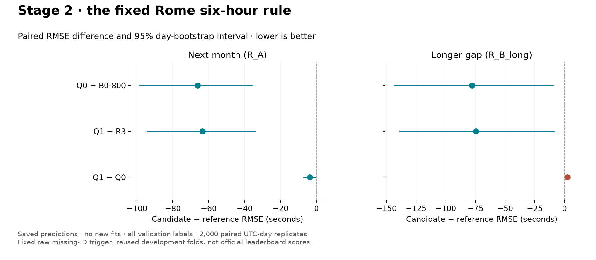

# Stage 2 — fixed Rome six-hour rule

**Complete. Carry Q0 forward as the conservative default; retain Q1 as a
next-month/longer-gap tradeoff.** The rule improves both main readouts for both
parents. Adding recovery to the rule improves next-month performance but
causes a supported longer-gap regression. The provisional combined difference
between Q1 and Q0 is inconclusive, so it does not establish a clear winner.

No new full benchmark models, full-year refits or submissions were produced.
Q0 and Q1 used the saved Stage 1 predictions and took **1.567 and 1.599 minutes**
each to register and score; the additional Q1-versus-Q0 comparison was separate.
The notebook recovery audits and CPU benchmarks were not repeated.

## Fixed definition and inheritance

For original Rome (`LIRF`) departures with a missing `FLIGHT_ID_mvt`, replace
the prediction with takeoff minus scheduled movement time when that gap is
**at least 21,600 seconds**. Raw missing-ID status remains the trigger even
after recovery. The rule does not inspect labels or block timestamps, modify
targets, add training inputs or change the scoring population.

- **Q0:** B0-800 (`v3_20260916T095948645262Z`) + rule; candidate
  [`v3_20260916T123230629423Z`](../runs/v3_20260916T123230629423Z/result.json).
- **Q1:** R3 (`v3_20260916T113256202842Z`) + rule; candidate
  [`v3_20260916T123433565511Z`](../runs/v3_20260916T123433565511Z/result.json).

Both preserve the six training windows, three seeds, A1–A6/B1–B10, all labels,
repeated-flight weighting and 2,000 paired UTC-day bootstrap replicates.
No threshold search or extra exception was added after inspecting failures.

## Scores and paired differences

| Recipe | R_A | R_B_long | R_combined |
|---|---:|---:|---:|
| B0-800 | 366.7465 | 334.1785 | 348.9770 |
| R3 | 360.5041 | 333.3043 | 345.6144 |
| Q0 = B0-800 + rule | 300.5904 | **256.1971** | 276.7374 |
| Q1 = R3 + rule | **296.9037** | 258.5505 | **276.1937** |

All values are seconds. Differences below are candidate minus reference;
negative favours the candidate.

| Comparison | R_A difference [95% interval] | R_B_long difference [95% interval] |
|---|---|---|
| Q0 − B0-800 | −66.1561 [−98.3525, −35.9451] | −77.9814 [−143.3944, −10.0573] |
| Q1 − R3 | −63.6005 [−94.3112, −34.1482] | −74.7538 [−138.6469, −8.5358] |
| Q1 − Q0 | −3.6867 [−6.8853, −0.7738] | +2.3534 [+0.6283, +4.1240] |

All three seeds agree with these directions. Q1 − Q0 next-month seed differences
are −4.1260, −3.5999 and −3.3348 s; longer-gap differences are +1.6118, +2.4803
and +2.9664 s. Its combined change is −0.5437 s [−2.3785, +1.2817], inconclusive.

[Comparison data and affected-flight summaries](stage2_comparison.json) ·
[Exportable figure](stage2_comparison.pdf) ·
[Full Q1 versus Q0 comparison](../runs/v3_20260916T123433565511Z/comparison_v3_20260916T123230629423Z_block1.json).

## Changed flights and the damaging override

The trigger and override values are identical for Q0 and Q1. It changes **44
unique flights** in R_A; eight of those flights also appear in R_B_long. The
counts below classify each flight by its mean squared-error change over seeds
and repeated training origins, not by an averaged-prediction ensemble.

| Month | Unique triggered flights | Helped | Harmed |
|---|---:|---:|---:|
| July | 16 | 16 | 0 |
| August | 10 | 9 | 1 |
| September | 9 | 9 | 0 |
| October | 1 | 1 | 0 |
| November | 4 | 4 | 0 |
| December | 4 | 4 | 0 |

Thus **43 of 44** next-month flights improve and **all eight** longer-gap
flights improve, for both parents. These are descriptions of the scored sample,
not estimated success probabilities for unseen flights.

The harmful case is movement **195015201**, on **2025-08-28**. Its recorded
taxi time is **1,078 s**, while the rule predicts **23,039 s**. Mean original
predictions across seeds are 19,472.85 s for B0-800 and 18,208.62 s for R3.
The rule worsens squared error by about 143.74 million and 188.79 million s²,
respectively. A long delay against schedule does not always mean a long
recorded taxi time; this case is retained rather than excluded or patched.

Every changed ID, fold, seed, original/rule prediction and absolute/squared
error change is listed in [Q0's CSV](../runs/v3_20260916T123230629423Z/changed_rows.csv)
and [Q1's CSV](../runs/v3_20260916T123433565511Z/changed_rows.csv).

## Ordinary flights, tail and recovery tradeoff

| Readout / slice | B0-800 | Q0 | R3 | Q1 |
|---|---:|---:|---:|---:|
| R_A ordinary RMSE (≤7,200 s) | 273.1353 | 273.3790 | 268.4723 | 268.7979 |
| R_A tail RMSE (>7,200 s) | 13,634.1588 | 6,965.9774 | 13,402.9634 | 7,028.0860 |
| R_B_long ordinary RMSE | 240.9446 | 240.9446 | 242.5586 | 242.5586 |
| R_B_long tail RMSE | 16,982.0055 | 6,389.9541 | 16,764.7075 | 6,568.8615 |

The large gain comes from tail errors. Q0's tail share of squared error falls
to 17.312% on R_A and 11.569% on R_B_long; Q1's is 18.063% and 12.004%.
The damaging August override slightly worsens next-month ordinary RMSE.
No longer-gap ordinary flight is overridden. The ≤12-second slice is also
unchanged by the rule: Q0 scores 615.4146/556.9626 s and Q1 scores
609.6855/575.6204 s on R_A/R_B_long. All such labels remain in scoring.

Raw Rome/no-AOBT-plan RMSE becomes 4,821.7124/4,606.3370 s for Q0 and
4,525.7819/4,727.3619 s for Q1. Availability is measured before recovery.
Because Q0 and Q1 predict identical values on triggered rows, their remaining
differences come entirely from flights outside the trigger. On longer gaps,
Q1's Rome RMSE is 11.1992 s worse than Q0; seven airports worsen overall.

## Decision and next stage

Select **Q0 as the conservative parent for Stage 3**: it gives a supported gain
over the recovery-off control on both main readouts and has the better
longer-gap score. Q1 is a useful retained alternative, with a supported
next-month advantage and a supported longer-gap disadvantage. Do not treat
its slightly lower combined point estimate as evidence that it dominates Q0.
Stage 3 should name Q0 explicitly and keep its fixed rule when testing new
clock features or residual prediction. No Stage 3 models were run here.

These remain reused local development folds. No official leaderboard claim
is inferred from the size of the gain.

## Reproducibility and checks

The shared rule is used by both `postprocess.py` and linked `submit.py` recipes.
Parent model source and new rule source are hashed separately, along with
parent/candidate prediction files. **All 45 tests pass**, including the exact
six-hour boundary, original-ID semantics after recovery, hidden-label
invariance, shuffled row alignment, unchanged inputs and recipe/source guards.
See [rule implementation and commands](../docs/PREDICTION_RULES.md).

Q1's linked model/rule source checks pass on the current code. Q0 retains
B0-800's existing frozen-source constraint: its full-year refit cannot silently
use the newer wrapper. That guard remains enforced; preparing a future full-year
reference must preserve the validated model implementation. No refit or upload
was performed, and no Stage 1 recovery/CPU audit was repeated.
