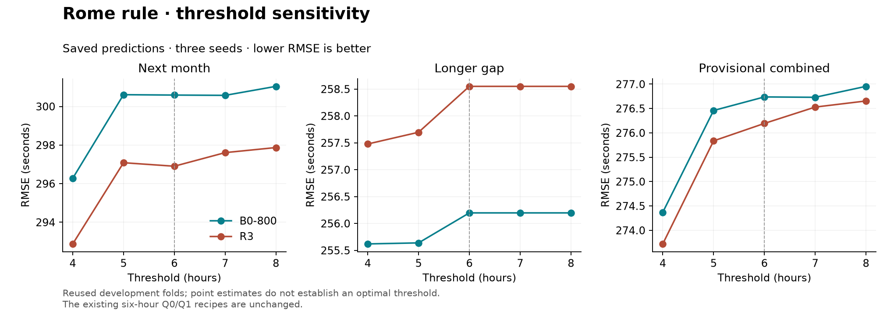

# Stage 2 follow-up — Rome threshold sensitivity

**Four hours has the best point estimates in the requested 4, 5, 6, 7 and 8
hour grid, for both B0-800 and R3.** Against six hours, next-month RMSE improves
by 4.31 s and 4.03 s respectively. Both improve in five of six months, with
November unchanged. The longer-gap gains are smaller and depend on only two
additional December flights. Treat four hours as a promising candidate, not an
independently confirmed optimum. Q0/Q1 remain the recorded six-hour recipes.

The user authorized this separate sensitivity experiment after Stage 2. The
five-point grid and both parents were fixed before running it. Scoring took
**1.621 minutes**, using saved predictions with **zero new model fits**. No
recovery audit, CPU benchmark, notebook cache rebuild, refit or upload ran.

## Scores

RMSE in seconds; lower is better. R_A is next-month validation; R_B_long is
longer-gap validation. R_combined uses the existing ranking-population weights
and combines squared errors, not arithmetic mean RMSE. These are local
development scores, not official leaderboard results.

| Threshold | B0-800 R_A | B0-800 R_B_long | B0-800 combined | R3 R_A | R3 R_B_long | R3 combined |
|---|---:|---:|---:|---:|---:|---:|
| Rule off | 366.7465 | 334.1785 | 348.9770 | 360.5041 | 333.3043 | 345.6144 |
| **4 h** | **296.2785** | **255.6200** | **274.3707** | **292.8785** | **257.4787** | **273.7215** |
| 5 h | 300.6098 | 255.6390 | 276.4591 | 297.0856 | 257.6968 | 275.8356 |
| 6 h | 300.5904 | 256.1971 | 276.7374 | 296.9037 | 258.5505 | 276.1937 |
| 7 h | 300.5749 | 256.1971 | 276.7300 | 297.6080 | 258.5505 | 276.5292 |
| 8 h | 301.0414 | 256.1971 | 276.9544 | 297.8710 | 258.5505 | 276.6546 |



[Scores CSV](stage2_threshold_sweep.csv) · [Full results and intervals](stage2_threshold_sweep.json) ·
[Monthly CSV](stage2_threshold_sweep_monthly.csv) · [Changed flights CSV](stage2_threshold_sweep_changed_rows.csv) ·
[Exportable figure](stage2_threshold_sweep.pdf).

## Four hours versus six hours

Differences are four-hour minus six-hour RMSE. Intervals use the same 2,000
paired UTC-day bootstrap draws, stratified by month, as Stage 2. They are
pointwise intervals without correction for testing several thresholds on
already-reused development folds.

| Parent | R_A difference [95% interval] | R_B_long difference [95% interval] | Combined difference [95% interval] |
|---|---|---|---|
| B0-800 | −4.3119 [−8.4472, −0.9998] | −0.5771 [−1.7312, 0.0000] | −2.3668 [−4.4364, −0.7044] |
| R3 | −4.0252 [−8.5625, −0.4379] | −1.0718 [−2.8531, 0.0000] | −2.4722 [−4.7819, −0.5618] |

All three seeds improve on both main readouts for each parent. Longer-gap
intervals touch zero because the extra corrections are sparse; they do not
establish a reliable longer-gap gain.

| Month | B0-800 R_A difference | R3 R_A difference |
|---|---:|---:|
| July | −2.3144 | −0.6249 |
| August | −5.2758 | −7.1809 |
| September | −15.9241 | −13.9915 |
| October | −0.9907 | −1.3673 |
| November | 0.0000 | 0.0000 |
| December | −0.9267 | −1.3849 |

Four hours improves both the ordinary (≤7,200 s) and tail next-month slices.
Longer-gap ordinary predictions and all ≤12-second slices remain unchanged.
Some helped ordinary flights still have large errors: movements 196130204
and 196126418 receive 14,702 s and 17,820 s despite labels of 1,145 s and
1,681 s. Their parent errors were worse. A helpful override therefore does not
prove that the schedule recovers the true taxi time.

## Helped and harmed flights

Counts classify each unique flight by its mean squared-error change from its
unmodified parent, averaged across seeds and repeated training origins.
Longer-gap flights also occur in R_A, so the columns must not be added.

| Threshold | R_A triggered | B0-800 helped / harmed | R3 helped / harmed | R_B_long triggered / helped / harmed, both parents |
|---|---:|---:|---:|---:|
| 4 h | 86 | 82 / 4 | 80 / 6 | 10 / 10 / 0 |
| 5 h | 59 | 55 / 4 | 55 / 4 | 9 / 9 / 0 |
| 6 h | 44 | 43 / 1 | 43 / 1 | 8 / 8 / 0 |
| 7 h | 39 | 39 / 0 | 39 / 0 | 8 / 8 / 0 |
| 8 h | 36 | 36 / 0 | 36 / 0 | 8 / 8 / 0 |

Lowering six to four hours adds 42 next-month flights: 39 improve and three
worsen for B0-800; 37 improve and five worsen for R3. Both retain the original
harmful 6.4-hour August case. Raising to seven hours removes that case but also
four helpful corrections: B0-800 changes by only −0.0155 s, while R3 worsens
by +0.7043 s. Neither difference is supported by its paired interval. Removing
all harmful overrides does not maximize the score.

At four hours, the recovery tradeoff persists: R3 versus B0-800 is −3.4000 s
[−6.0966, −1.0301] on R_A but +1.8587 s [+0.3552, +3.3511] on R_B_long.
The combined difference is −0.6491 s [−2.1790, +0.8699], inconclusive.
There is still no parent that clearly dominates both readouts.

## Reproduce and retain

```bash
OPENBLAS_NUM_THREADS=2 OMP_NUM_THREADS=2 .venv/bin/python VALIDATION/tools/sweep_rule_thresholds.py
```

Default parents are B0-800 `v3_20260916T095948645262Z` and R3
`v3_20260916T113256202842Z`. Controls are Q0 `v3_20260916T123230629423Z`
and Q1 `v3_20260916T123433565511Z`. The tool checks data identity and saved
prediction hashes against Stage 2, verifies matching folds/labels/seeds,
and reproduces both unmodified and six-hour headline scores to 1e−9 s.
Six-hour trigger IDs match the existing changed-row records.

The trigger keeps the original LIRF/missing-ID condition and inclusive gap
boundary; only the threshold varies. All validation labels remain in scoring.
The implementation averages losses over repeated origins before applying a
deterministic override; the added test checks equivalence to overriding each
origin's predictions first. All **47 tests pass**, including boundary,
raw-field eligibility, label invariance and existing submission guards.

This diagnostic produces no new submission recipe and does not relabel Q0 or
Q1. Carry the four-hour finding forward as a candidate for later confirmation;
preserve the six-hour control for Stage 3 comparisons. No smaller thresholds
were tested or inferred to be better from this boundary result.
