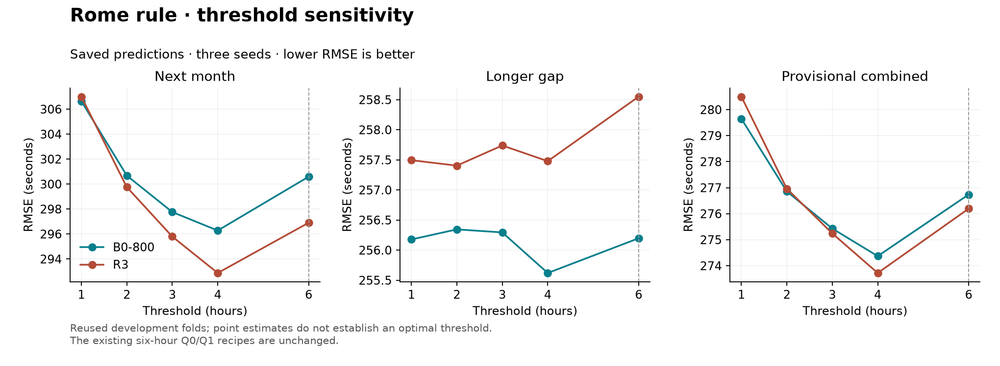

# Stage 2 follow-up — one, two and three hour thresholds

**Four hours remains the best next-month and combined point estimate for both
parents across the tested 1–8 hour range.** Baseline also prefers four hours
on longer gaps. R3's longer-gap minimum is two hours, but its advantage over
four is only 0.0744 s and is inconclusive. Keep four hours as the leading
sensitivity candidate; the existing Q0/Q1 recipes remain six-hour controls.

The user requested 1, 2 and 3 hours after four hours was the lower boundary
of the [original 4–8 hour sweep](STAGE2_THRESHOLD_SWEEP.md). This extension
uses the same saved B0-800/R3 predictions and includes four- and six-hour
controls. It took **1.631 minutes**, with **zero new fits**. The original sweep
artifacts are preserved. No recovery audit, CPU benchmark or upload ran.

## Local scores

RMSE in seconds; lower is better. These are reused development folds, not
official leaderboard scores. The provisional combined score uses the existing
ranking-population weights on squared errors.

| Threshold | B0-800 next month | B0-800 longer gap | B0-800 combined | R3 next month | R3 longer gap | R3 combined |
|---|---:|---:|---:|---:|---:|---:|
| 1 h | 306.6383 | 256.1773 | 279.6505 | 307.0006 | 257.4945 | 280.4992 |
| 2 h | 300.6796 | 256.3447 | 276.8564 | 299.7589 | **257.4043** | 276.9620 |
| 3 h | 297.7620 | 256.2949 | 275.4306 | 295.7965 | 257.7390 | 275.2434 |
| **4 h** | **296.2785** | **255.6200** | **274.3707** | **292.8785** | 257.4787 | **273.7215** |
| 6 h control | 300.5904 | 256.1971 | 276.7374 | 296.9037 | 258.5505 | 276.1937 |



[Scores CSV](stage2_threshold_sweep_low.csv) · [Full results and intervals](stage2_threshold_sweep_low.json) ·
[Monthly CSV](stage2_threshold_sweep_low_monthly.csv) · [Changed flights](stage2_threshold_sweep_low_changed_rows.csv) ·
[Figure PDF](stage2_threshold_sweep_low.pdf).

## Differences from four hours

Positive differences mean worse RMSE. Intervals use 2,000 paired UTC-day
bootstrap draws stratified by month, with identical seeds and flight/origin
weighting to the previous experiments.

| Parent / threshold | Next-month difference [95% interval] | Longer-gap difference [95% interval] | Combined difference [95% interval] |
|---|---|---|---|
| B0-800 / 1 h | +10.3598 [+6.6885, +14.1351] | +0.5573 [−1.6580, +2.7778] | +5.2798 [+3.0464, +7.5382] |
| B0-800 / 2 h | +4.4011 [+1.1514, +7.5078] | +0.7247 [−1.2185, +2.9197] | +2.4858 [+0.6037, +4.5382] |
| B0-800 / 3 h | +1.4835 [−1.2629, +4.0138] | +0.6749 [−0.5499, +2.1757] | +1.0599 [−0.4110, +2.5943] |
| R3 / 1 h | +14.1220 [+9.4681, +18.7038] | +0.0158 [−2.2623, +2.3790] | +6.7776 [+4.1150, +9.3511] |
| R3 / 2 h | +6.8804 [+2.6195, +10.8145] | −0.0744 [−1.8708, +1.7255] | +3.2405 [+0.9880, +5.4110] |
| R3 / 3 h | +2.9180 [−0.5894, +5.9203] | +0.2603 [−0.3294, +0.9810] | +1.5219 [−0.2490, +2.9971] |

One and two hours have supported next-month and combined regressions for both
parents. Three hours has worse point estimates, but its intervals include zero.
All longer-gap differences are inconclusive. All three seeds agree that the
lower thresholds worsen next-month RMSE. Three versus four hours worsens five
of six next-month validation months for both parents; December improves slightly.

This was an adaptive extension after viewing the previous sweep. Intervals
are pointwise, without multiplicity correction, on the same development folds.
They do not independently confirm four hours as an optimal cutoff.

## Additional overrides

Counts below compare each threshold with its unmodified parent, using mean
squared error over seeds and repeated origins for each unique flight.

| Threshold | Next-month triggered | B0-800 helped / harmed | R3 helped / harmed | Longer-gap triggered | B0-800 helped / harmed | R3 helped / harmed |
|---|---:|---:|---:|---:|---:|---:|
| 1 h | 897 | 457 / 440 | 445 / 452 | 123 | 93 / 30 | 92 / 31 |
| 2 h | 409 | 271 / 138 | 267 / 142 | 58 | 49 / 9 | 48 / 10 |
| 3 h | 169 | 127 / 42 | 124 / 45 | 19 | 17 / 2 | 17 / 2 |
| 4 h | 86 | 82 / 4 | 80 / 6 | 10 | 10 / 0 | 10 / 0 |

Moving from four to three hours adds 83 next-month overrides. For B0-800,
45 help and 38 harm; for R3, 44 help and 39 harm. Their total squared error
increases despite a small majority helping. Lower thresholds improve tail
RMSE but worsen ordinary-flight RMSE enough to lose overall: for example,
at one hour B0-800 ordinary RMSE rises from 270.58 to 285.92 s, while R3 rises
from 267.22 to 286.22 s. The same ordinary-versus-tail tradeoff occurs at two
and three hours. Longer-gap flights overlap the next-month population; counts
must not be added across groups.

## Reproduce

```bash
OPENBLAS_NUM_THREADS=2 OMP_NUM_THREADS=2 .venv/bin/python VALIDATION/tools/sweep_rule_thresholds.py \
  --hours 1 2 3 4 6 --output VALIDATION/reports/stage2_threshold_sweep_low
```

The tool retains raw LIRF/missing-ID eligibility, inclusive thresholds and
all validation labels. It verifies data and saved-prediction identities,
preserves model/source provenance and exports comparisons between every
threshold in the requested grid. Unmodified, four-hour and six-hour scores
match the previous artifacts to 1e−9 s for both parents. All **47 tests pass**.
No model or linked submission rule was changed, and Stage 3 has not run.
