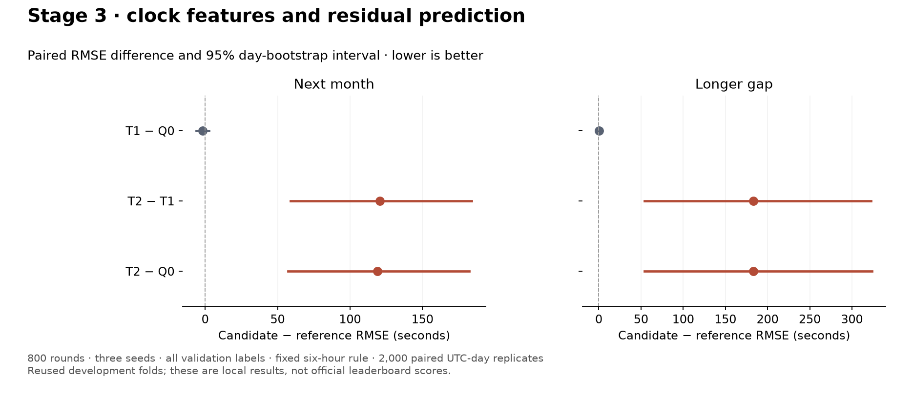
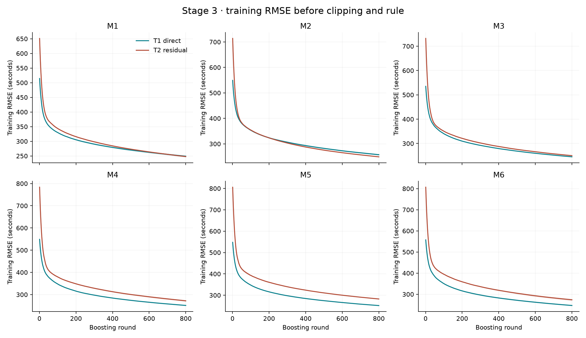

# Stage 3 — clock features and residual prediction

**Complete. Retain Q0 as the conservative control. T1 is inconclusive; do not
promote T2.** Explicit clock features make little difference overall. The tested
residual model performs substantially worse because it fails to correct some
very large schedule gaps when flight-plan clocks are missing.

T1 and T2 took **19.470 and 19.292 minutes**, respectively, including their
registered scoring. Each fitted 18 models and produced 48 prediction files
across the same six training windows, three seeds and 16 validation folds.
The additional T2-versus-Q0 comparison and saved-error inspection were separate.
No recovery audit, CPU benchmark, notebook cache rebuild, full-year refit or
upload ran. Training used one worker, six fit threads and 20 prediction threads
on the i7-13650HX laptop.

## What changed

- **Q0:** B0-800 plus the fixed six-hour Rome rule; saved control
  [`v3_20260916T123230629423Z`](../runs/v3_20260916T123230629423Z/result.json).
- **T1:** Q0 plus 18 explicit clock differences, availability/provenance fields,
  summaries and a fixed clock baseline; predict taxi time directly.
  [`v3_20260916T132038893775Z`](../runs/v3_20260916T132038893775Z/result.json).
- **T2:** Exactly T1's features and training rows, but fit the correction
  `taxi_time − clock_baseline`. Add the baseline back before clipping and
  applying the same rule.
  [`v3_20260916T134231489815Z`](../runs/v3_20260916T134231489815Z/result.json).

The [design was fixed before training](../docs/CLOCK_MODELS.md). The baseline
uses takeoff minus the first available clock in AOBT3 → EOBT1 → IOBT → LOBT →
schedule order, clipped to zero from below, with zero if all clocks are missing.
No clock calibration or reliability threshold was fitted or tuned.

Recovery stays off. Both candidates use 800 rounds, seeds 42/142/242, training
labels 1–200,000 s and all validation labels. Rule-handled rows remain in
training. Four hours remains a separate sensitivity candidate; it was not mixed
into this comparison with the six-hour Q0 control.

## Scores and comparisons

Local RMSE in seconds; lower is better. R_A covers 1,079,528 unique next-month
flights; R_B_long covers 328,009 longer-gap flights. The combined score retains
the existing ranking-population weighting. These are not leaderboard scores.

| Recipe | R_A | R_B_long | Combined |
|---|---:|---:|---:|
| Q0 | 300.5904 | **256.1971** | 276.7374 |
| T1, direct with clock features | **298.9328** | 256.2445 | **275.9656** |
| T2, clock residual | 419.6226 | 439.4680 | 430.7919 |

Differences are candidate minus reference. Intervals are the existing 2,000
paired UTC-day bootstrap replicates, stratified by month and retaining equal
weight per flight across seeds and repeated training origins.

| Comparison | R_A difference [95% interval] | R_B_long difference [95% interval] |
|---|---|---|
| T1 − Q0 | −1.6576 [−6.0420, +2.5997] | +0.0474 [−2.8840, +3.4262] |
| T2 − T1 | +120.6899 [+58.9155, +184.1025] | +183.2235 [+54.0967, +322.5573] |
| T2 − Q0 | +119.0322 [+57.1863, +182.2481] | +183.2709 [+54.1155, +323.5899] |

T1's combined change is −0.7718 s [−3.3654, +1.9707], also inconclusive.
All three seeds show its small next-month improvement, but their longer-gap
directions differ. T1 improves four next-month validation months and worsens
October and December. T2 worsens every next-month validation month, and all
three seeds agree on its regression in both main readouts.



[Comparison data](stage3_comparison.json) · [Figure PDF](stage3_comparison.pdf) ·
[Full T2 versus Q0 report](../runs/v3_20260916T134231489815Z/comparison_v3_20260916T123230629423Z_block1.json).

## Why this residual model failed

A bounded inspection of saved prediction errors identifies the **schedule
fallback** as the dominant problem. The following slices are descriptive,
selected after seeing the regression; they are not new promotion tests.

| Clock source / readout | Unique flights | T1 RMSE | T2 RMSE |
|---|---:|---:|---:|
| AOBT3 available, R_A | 1,065,877 | 246.5762 | 237.3705 |
| Schedule fallback, R_A | 13,651 | 1,522.9636 | 3,086.3113 |
| AOBT3 available, R_B_long | 325,004 | 225.2307 | 225.2177 |
| Schedule fallback, R_B_long | 3,005 | 1,296.4030 | 3,949.0896 |

The fallback adds the schedule gap to the learned correction. Some of those
gaps are enormous even though the recorded taxi time is ordinary, and the
model does not cancel them sufficiently. For example, Amsterdam movement
**200741002** has a 151,639-second baseline (**42.1 hours**) and a 549-second
label (**9.15 minutes**). Its mean next-month T2 prediction is 132,665 seconds
(**36.9 hours**), versus 2,663 seconds from T1. The Rome-only rule does not
apply to this flight.

Only 15 next-month flights have a baseline over 24 hours; their net error
increase contributes 74.90 billion s² of the total 93.62 billion s² regression
versus T1. Four such longer-gap flights contribute 32.42 billion s² out of
41.81 billion s². These cohorts overlap across readouts and must not be added.
The full saved-error diagnosis lists the worst affected IDs and source slices:
[residual error diagnosis](stage3_residual_errors.json).

T2 improves the tail slice but substantially harms ordinary flights:

| Slice | Q0 | T1 | T2 |
|---|---:|---:|---:|
| R_A ordinary (≤7,200 s) | 273.3790 | 272.9175 | 409.3659 |
| R_A tail (>7,200 s) | 6,965.9774 | 6,798.8097 | 5,152.0625 |
| R_B_long ordinary | 240.9446 | 239.1531 | 431.3306 |
| R_B_long tail | 6,389.9541 | 6,751.7553 | 6,187.8138 |

The ≤12-second slice is retained: Q0/T1/T2 score 615.4146/628.6023/928.3076 s
on R_A and 556.9626/579.9094/582.3787 s on R_B_long. No affected row was removed
or repaired after inspecting these results.

The failure of this global clock-residual baseline does not settle the user's
future proposal to learn corrections specifically for rule-handled cases.
That is a separate experiment, after the proposed leaderboard-transfer check.
Any later global residual candidate must explicitly address the schedule
fallback rather than silently changing this frozen T2 recipe.

## Checks, artifacts and next work

All **51 tests pass**, including explicit feature/label isolation, fallback
order, negative residuals, reconstruction before clipping, saved-model replay,
checkpoint/rule order and linked recipe overrides. Actual T1 and T2 linked
submission source checks pass. Both runs have identical training row counts
and feature names. Per-round training losses, models and predictions are saved;
model/rule source hashes and data identities remain recorded.



Lines show mean training RMSE over the three seeds; shading spans their range.
These losses are before final clipping and the rule. Their continued decline
does not establish a validation gain. [Training figure PDF](stage3_training_loss.pdf).

Keep Q0 as the conservative parent. Retain T1 as an inconclusive alternative;
do not promote T2 or start another tuning sweep. Stage 4 (separating ordinary
and anomalous timestamp cases) remains planned and has not run. The user's
future leaderboard check, training-row routing discussion and specialized
rule-correction idea remain recorded in the improvement plan. No submission
selection, refit or upload was performed here.

Reproduce the summary from saved completed runs:

```bash
.venv/bin/python VALIDATION/compare.py --run v3_20260916T134231489815Z --baseline v3_20260916T123230629423Z
.venv/bin/python VALIDATION/tools/summarize_clock_models.py --t1 v3_20260916T132038893775Z --t2 v3_20260916T134231489815Z
.venv/bin/python VALIDATION/tools/inspect_clock_residual_errors.py --t1 v3_20260916T132038893775Z --t2 v3_20260916T134231489815Z
```
