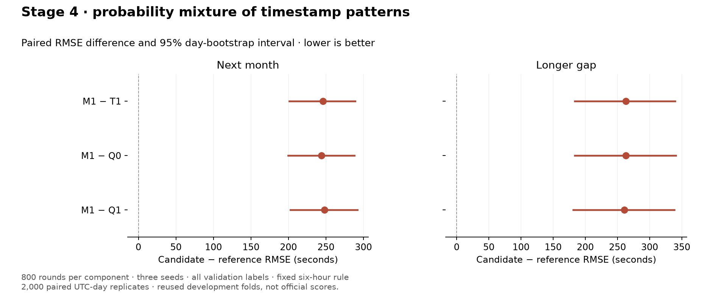
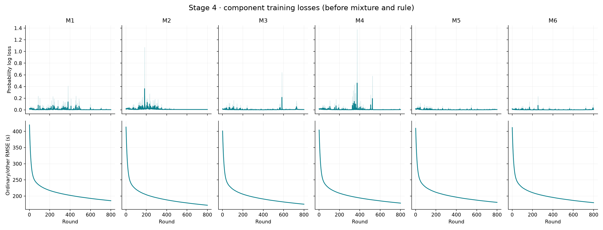

# Stage 4 — probability mixture of timestamp patterns

**Complete. Do not promote M1; retain Q0 as the conservative control.** The
tested mixture substantially regresses against T1, Q0 and Q1. Its classifier
makes overconfident mistakes on ordinary flights, sometimes assigning them a
schedule-gap or extra-day prediction. Both ordinary and extreme-label error
worsen. This result rejects the frozen M1 recipe, not every possible mixture.

Run [`v3_20260916T144408082362Z`](../runs/v3_20260916T144408082362Z/result.json)
took **51.768 minutes**, including its registered T1 comparison. The extra
Q0/Q1 comparisons and saved-prediction summary were separate, with no new fits.
The i7-13650HX laptop used one worker, six fit threads and 20 prediction threads.
No recovery audit, CPU probe, notebook-cache rebuild, full-year refit or upload
ran. All 36 boosters, 18 bundles and 48 fold/seed prediction files are saved.

## What changed

The [design was fixed before fitting](../docs/TIMESTAMP_MIXTURE.md). M1 keeps
T1's 45 features and replaces the single regressor with two boosters:

- A three-class probability model, trained on every retained training row.
  Schedule cases have target >7,200 seconds and target within 60 seconds of
  the visible schedule gap. Otherwise, one-day cases have target minus 86,400
  in [1, 7,200]. Everything else is ordinary/other, including unmatched tails.
- A direct taxi-time regressor fitted on ordinary/other training rows.

Predictions combine the ordinary regressor, the visible schedule gap and the
ordinary prediction plus 86,400 seconds, weighted by the classifier's
probabilities. The unchanged six-hour Rome rule runs last. Missing schedule
gaps fall back to the ordinary prediction. These are operational label patterns,
not established physical causes.

Recovery stays off; each booster uses 800 rounds, seeds 42/142/242 and the
existing tree/learning parameters. Training labels remain 1–200,000 seconds;
all validation labels remain scored. Classifier training includes rule-eligible
rows. This component split is separate from the future proposal to exclude
rows using the observable Rome-rule trigger. No such routing experiment ran.

## Scores and paired comparisons

Local RMSE in seconds; lower is better. R_A covers 1,079,528 unique flights and
R_B_long covers 328,009. These are reused development folds, not LB scores.

| Recipe | R_A | R_B_long | Combined |
|---|---:|---:|---:|
| Q0, conservative control | 300.5904 | **256.1971** | 276.7374 |
| Q1, recovery tradeoff | **296.9037** | 258.5505 | 276.1937 |
| T1, feature-matched direct parent | 298.9328 | 256.2445 | **275.9656** |
| M1, timestamp mixture | 544.8410 | 519.0849 | 530.6457 |

Differences are M1 minus reference. All intervals use 2,000 paired UTC-day
bootstrap replicates with the existing month stratification and flight weights.

| Comparison | R_A difference [95% interval] | R_B_long difference [95% interval] |
|---|---|---|
| M1 − T1 | +245.9083 [+201.2976, +288.7509] | +262.8404 [+183.8792, +339.6929] |
| M1 − Q0 | +244.2506 [+199.5467, +287.7271] | +262.8877 [+183.5490, +340.7331] |
| M1 − Q1 | +247.9374 [+202.6499, +292.2035] | +260.5344 [+181.3948, +338.3047] |

All are supported regressions. The combined difference versus Q0 is +253.9083
seconds [+207.7464, +302.7948]; it also regresses versus T1 and Q1.
Every next-month fold is worse than T1: July/August/September/October/November/
December score **752.5200/413.1330/426.1206/534.8557/613.2842/441.2508**.
Every seed regresses in both main readouts, with substantial seed variation:

| Seed | M1 R_A | M1 R_B_long |
|---|---:|---:|
| 42 | 479.3851 | 319.6820 |
| 142 | 366.8836 | 282.8478 |
| 242 | 725.3563 | 791.2950 |



[Comparison/slice data](stage4_comparison.json) · [Figure PDF](stage4_comparison.pdf) ·
[Full Q0 comparison](../runs/v3_20260916T144408082362Z/comparison_v3_20260916T123230629423Z_block1.json) ·
[Full Q1 comparison](../runs/v3_20260916T144408082362Z/comparison_v3_20260916T123433565511Z_block1.json).

## False high predictions and concrete failures

For this diagnostic, an ordinary row has target ≤7,200 seconds; a false high
prediction exceeds 7,200 seconds. Count a unique flight once if **any** seed
or training origin produces such a prediction. Squared errors are averaged
over seeds and repeated origins before summing; predictions are not averaged
before scoring.

| Readout / ordinary population | Q0 false-high flights | T1 | M1 |
|---|---:|---:|---:|
| R_A, all airports | 112 | 107 | 287 |
| R_A, Rome | 96 | 87 | 118 |
| R_B_long, all airports | 13 | 14 | 92 |
| R_B_long, Rome | 12 | 9 | 13 |

The severity matters more than the counts. Ordinary Rome RMSE rises from
**581.5245 to 987.3211** seconds next-month and **388.8186 to 668.6052**
longer-gap, versus Q0. The next-month false-high squared-error contribution
there rises from **10.12 to 65.76 billion s²**; longer-gap rises from **0.32
to 7.53 billion s²**. Averaged over seeds/origins, Rome actually has fewer
high events (80.33→53.33 flight-equivalents next-month; 9.17→3.83 longer-gap),
but their much larger errors dominate. This is why counts alone are inadequate.

Across all airports, the increase in false-high ordinary-row error accounts
for **88.5% of the net extra R_A squared error** and **96.9% of the net extra
R_B_long squared error**, versus Q0. These are diagnostic decompositions of the
completed result, not target-based prediction rules.

**Rome movement `192616462`:** target **1,144 seconds (19.1 minutes)**,
schedule gap **12,182 seconds (3.4 hours)**, so the six-hour rule does not apply.
Seeds 42 and 142 assign essentially all probability to schedule and predict
12,182 seconds. Seed 242 assigns essentially all probability to the day class
and predicts **90,324 seconds (25.1 hours)**. Its ordinary component predicted
3,924 seconds before the extra day was added. A soft-probability formula does
not protect against probabilities that become nearly zero or one.

**The Stage 3 Amsterdam failure, movement `200741002`:** target **549 seconds**,
schedule gap **151,639 seconds**. M1's next-month predictions are **738, 821,
943 seconds**: this case improves considerably versus T2. But in longer-gap
folds, **B4/seed 42 and B7/seed 242 predict the entire 151,639-second gap**,
with schedule probability essentially one. Its longer-gap mean prediction is
51,363 seconds across seeds/origins. It is not a robust fix for that case.
Individual saved predictions for both examples are included in the comparison
JSON, alongside the worst ordinary Rome and all-airport changes.

The existing damaging six-hour override (`195015201`) remains unchanged.
M1's additional false highs largely occur outside that trigger: removing the
one rule-triggered ordinary Rome row still leaves next-month RMSE 984.3649
versus Q0's 576.4845. No ordinary longer-gap Rome row triggers the rule.

## Other target slices and component training

| Slice | Q0 | T1 | M1 |
|---|---:|---:|---:|
| R_A ordinary | 273.3790 | 272.9175 | 502.6968 |
| R_A tail >7,200 s | 6,965.9774 | 6,798.8097 | 11,713.3623 |
| R_B_long ordinary | 240.9446 | 239.1531 | 502.8099 |
| R_B_long tail | 6,389.9541 | 6,751.7553 | 9,470.0824 |

The ≤12-second slice remains included: M1 scores **623.2444/567.6563** seconds
(R_A/R_B_long), versus Q0's 615.4146/556.9626. Full airport, month, seed and
availability slices remain in the run report and comparison JSON.

The day class is extremely small. Training counts are identical across seeds
within each window; windows overlap, so their counts must not be added:

| Training window | Ordinary/other | Schedule | One extra day |
|---|---:|---:|---:|
| January–June | 1,005,123 | 162 | 5 |
| February–July | 1,042,067 | 235 | 8 |
| March–August | 1,089,469 | 276 | 8 |
| April–September | 1,108,964 | 292 | 8 |
| May–October | 1,119,353 | 301 | 8 |
| June–November | 1,096,496 | 290 | 9 |

The classifier's training log loss has sharp spikes, while the ordinary
regressor's training RMSE falls smoothly. Combined with the seed variation
and near-certain wrong classifications above, this shows instability in the
tested probability model. No calibration, class weighting, early stopping,
or replacement recipe was added after seeing the result.



Lines average the three seeds; shading spans their range. Columns M1–M6 here
are the six **training-window IDs**, not six mixture candidates. These are
component training losses, before combination and the Rome rule.
[Training figure PDF](stage4_training_loss.pdf).

## Checks and next work

All **55 tests passed**, covering outcome boundaries/precedence, missing-clock
fallback, absent rare classes, probability reconstruction, validation-label
isolation, bundle replay, checkpoint/rule order, resume reuse and recipe guards.
The actual completed M1 linked-submission model/rule checks pass. T1 and M1
have identical feature names and total retained training counts for all windows;
their data identities match. The summary independently reproduces the main
scores from saved errors to 1e−9. The experiment ledger contains one completed
entry. No full benchmark fit was repeated.

Stages 1–4 are complete. Keep Q0 as the conservative control, Q1 as a tradeoff,
and four hours as the separate leading threshold candidate. Do not promote M1
or silently tune the failed classifier. Candidate selection and controlled
leaderboard checks are next; full-year refits and uploads remain deferred.

The expanded LB scope records official and CV scores together, matched
candidate-minus-control changes, direction agreement, LB-minus-CV gaps and
delta-LB-minus-delta-CV, with seed-42 CV beside the standard seed average.
See the [submission scope](../IMPROVEMENT_PLAN.md#tomorrow-controlled-leaderboard-checks).
The future rule-row training exclusion and specialist rule correction remain
separate proposals, conditional on that leaderboard discussion.

Reproduce the saved-result comparisons and summary, without fitting:

```bash
.venv/bin/python VALIDATION/compare.py --run v3_20260916T144408082362Z --baseline v3_20260916T123230629423Z
.venv/bin/python VALIDATION/compare.py --run v3_20260916T144408082362Z --baseline v3_20260916T123433565511Z
.venv/bin/python VALIDATION/tools/summarize_timestamp_mixture.py --run v3_20260916T144408082362Z
```
