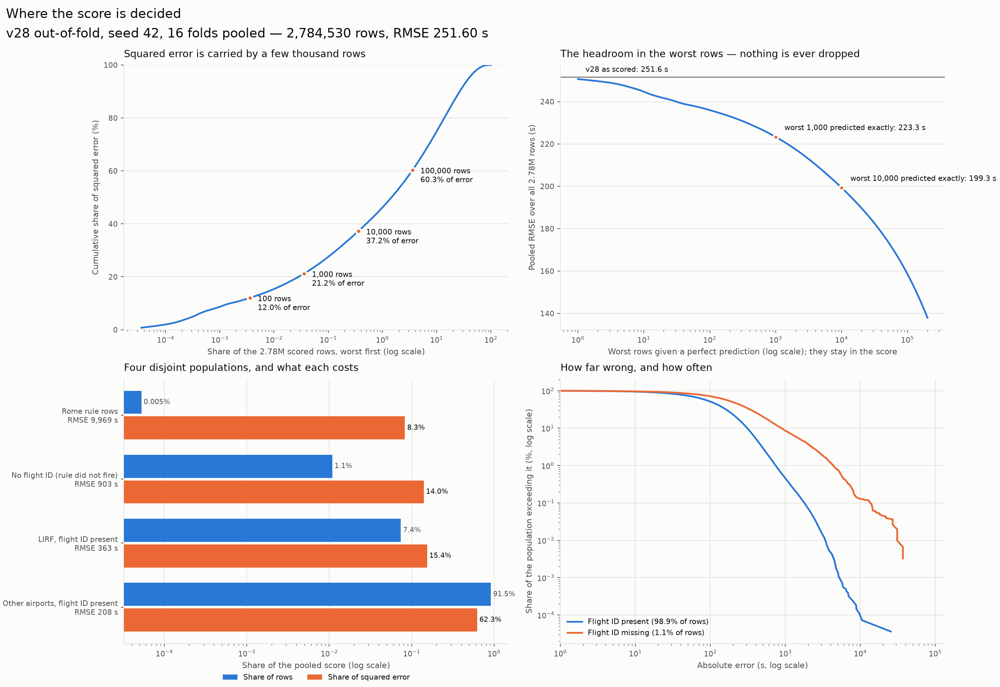
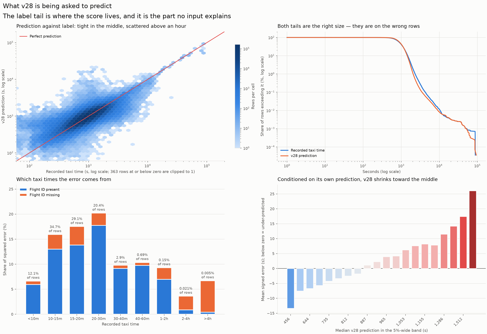
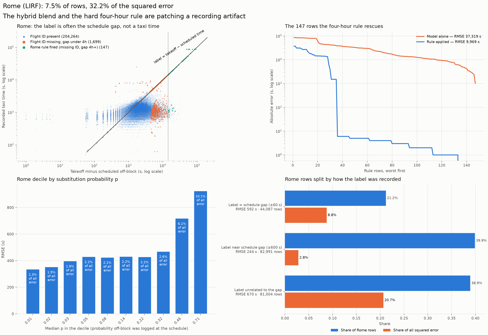
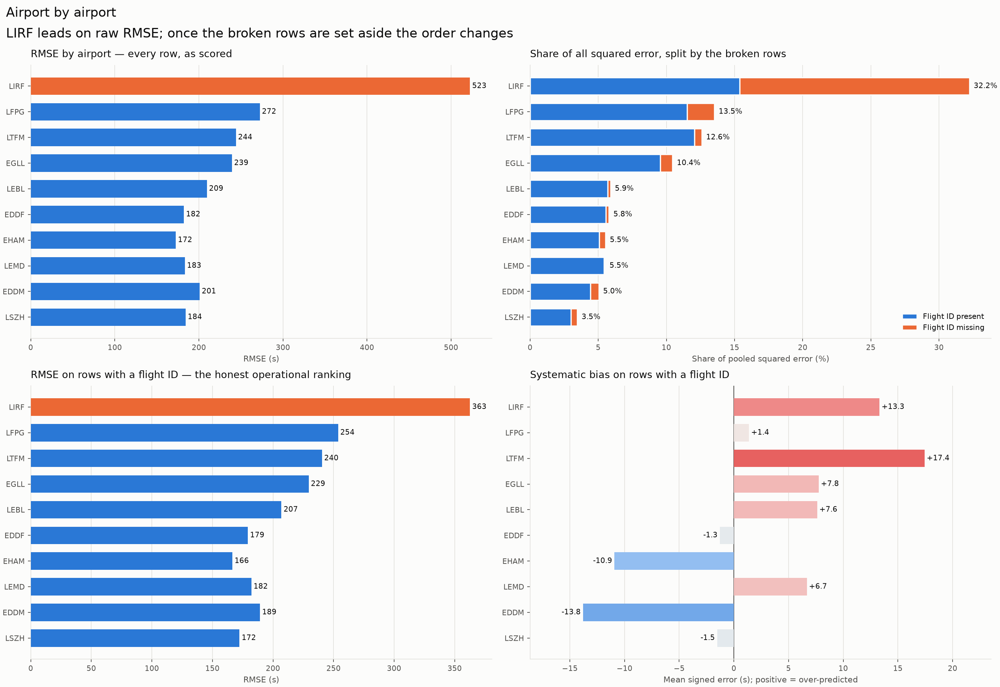
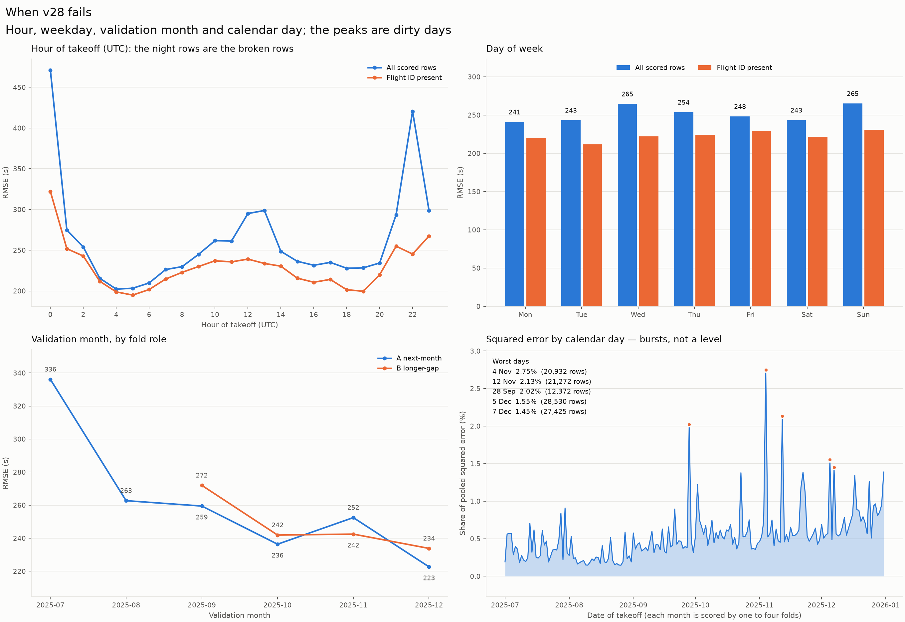
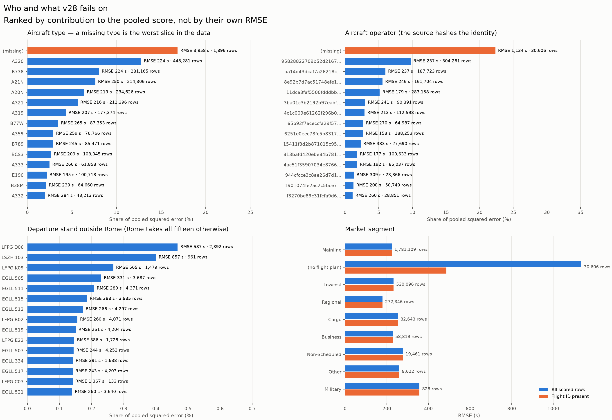
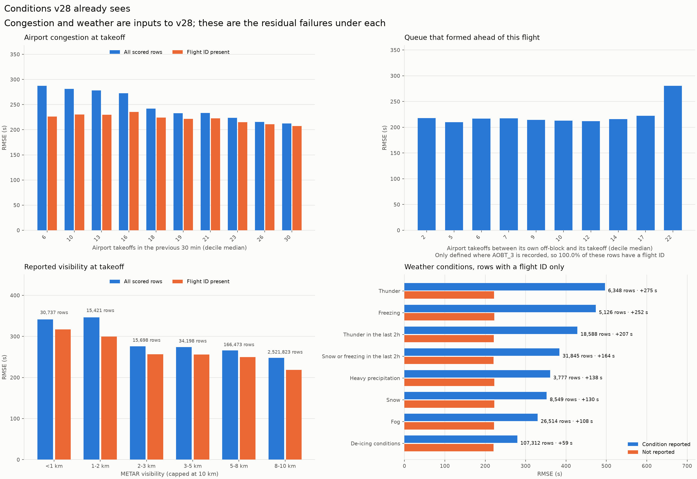
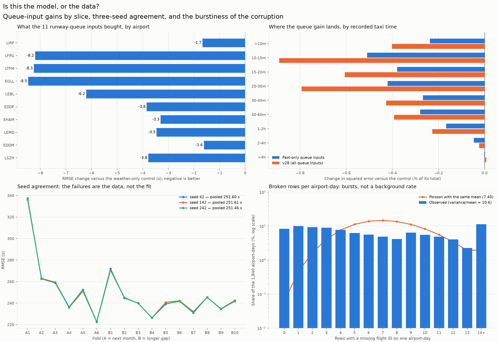

# Where v28 fails

v28 is row 28 of [SUBMISSIONS.md](../SUBMISSIONS.md), **Rome-hybrid-4h-clock-weather-queue**:
the Rome schedule-substitution hybrid with the four-hour rule, the 18 clock inputs, 21 METAR
weather inputs and 11 runway-queue inputs. It is the best validated recipe we have
(CV 248.6174 s combined) and has never been submitted.

Everything below is read from the saved out-of-fold predictions of run
`v3_20260917T172934966809Z` — **no model was refitted**. Seed 42, all 16 folds pooled:
2,784,530 scored rows over 1,079,528 distinct flights, July–December 2025,
pooled RMSE **251.60 s**. Reproduce with:

```sh
.venv/bin/python VALIDATION/tools/analyze_v28_failures.py
```

## The short answer

v28 does not fail at predicting taxi times. It fails on a small set of rows whose
recorded label is not a taxi time at all, and those rows decide the score.

- **21.2% of all squared error comes from 1,000 rows** — 0.036% of the data.
  Predict those 1,000 rows exactly, leaving every other prediction and every scored row
  untouched, and the pooled score is **223.3 s** instead of 251.60 s.
  Nothing here is ever excluded from the score: these rows are in `ranking.parquet` too, at a
  *higher* rate than in validation, so this is headroom to win, not data to clean away.
- **Rows with no `FLIGHT_ID_mvt`** are 1.096% of the data and
  **22.32% of the squared error**: RMSE 1,135.6 s
  against 223.0 s for everything else.
- **The four-hour Rome rule fires on 147 rows** — 0.005% of the data — and those
  rows still carry **8.29% of the squared error** (RMSE 9,969 s).
  They are the single most valuable thing in the model: without the rule, the model alone
  scores 37,319 s on them and the pooled score falls apart to
  **362.7 s**.
- **Labels above one hour** are 4,741 rows (0.170%) and
  **19.6% of the squared error**. v28's predicted distribution is
  roughly the right shape — its 99.9th percentile is 3,520 s against the label's
  4,313 s — but the big predictions are on the wrong rows: of the rows it predicts
  above an hour, **73.2%** really are, and it catches **40.7%** of
  the ones that are.
- **A missing `AIRCRAFT_TYPE_mvt`** marks 1,896 rows — 0.068% —
  that carry **16.8% of the squared error** at RMSE 3,958 s.
  100% of them also have no flight ID: it is the same corruption seen
  from a second column, and it is the sharpest single flag in the data.
- 363 rows carry a taxi time **at or below zero seconds** and 1,107 are under a
  minute. Nothing taxied in that time either.
- The corruption is **bursty**, not a background rate: variance/mean of broken rows per
  airport-day is **10.6** against 1.0 for Poisson, over 1,840 airport-days.
  The worst single day (2025-11-04) is 2.7% of the pooled score by itself.

All three seeds agree to within 0.15 s pooled, so none of this is fit noise.

## Four disjoint populations

| Population | Rows | Share of rows | RMSE (s) | Share of squared error | Mean bias (s) |
| --- | --- | --- | --- | --- | --- |
| Rome rule rows | 147 | 0.005% | 9,969.2 | 8.29% | -694.0 |
| No flight ID (rule did not fire) | 30,367 | 1.091% | 902.6 | 14.03% | +21.4 |
| LIRF, flight ID present | 206,219 | 7.406% | 362.7 | 15.39% | +13.3 |
| Other airports, flight ID present | 2,547,797 | 91.498% | 207.6 | 62.29% | +2.3 |

The first two populations together are 1.10% of the data and
22.3% of the score.

## Airport by airport

| Airport | Rows | RMSE (s) | Share of squared error | Missing flight ID | RMSE with flight ID (s) | Bias with flight ID (s) |
| --- | --- | --- | --- | --- | --- | --- |
| LIRF | 208,082 | 522.5 | 32.23% | 0.90% | 362.7 | +13.3 |
| LFPG | 321,058 | 272.4 | 13.52% | 1.82% | 253.8 | +1.4 |
| LTFM | 372,784 | 244.0 | 12.59% | 1.43% | 240.5 | +17.4 |
| EGLL | 321,557 | 239.3 | 10.45% | 0.62% | 229.5 | +7.8 |
| LEBL | 237,039 | 209.5 | 5.90% | 1.03% | 207.0 | +7.6 |
| EDDF | 307,635 | 182.1 | 5.79% | 0.72% | 179.3 | -1.3 |
| EHAM | 327,612 | 172.5 | 5.53% | 1.71% | 166.5 | -10.9 |
| LEMD | 288,928 | 183.3 | 5.51% | 0.44% | 182.1 | +6.7 |
| EDDM | 220,089 | 200.8 | 5.04% | 0.71% | 189.2 | -13.8 |
| LSZH | 179,746 | 184.1 | 3.46% | 1.37% | 172.3 | -1.5 |

LIRF leads on raw RMSE only because of the substitution artifact. On rows that have a flight
ID its RMSE is 362.7 s — above the ten-airport median of
198.1 s, but no longer an outlier.

## The twenty-five worst individual flights

| Airport | Takeoff | Label (s) | v28 (s) | Error (s) | Takeoff − schedule (min) | Rome rule | Flight ID | Type | Stand | Folds |
| --- | --- | --- | --- | --- | --- | --- | --- | --- | --- | --- |
| LIRF | 2025-09-28 22:38 | 87,543 | 50,581 | -36,962 | 843 | fired | missing | (missing) | 609 | 2 |
| LIRF | 2025-11-04 13:22 | 87,480 | 56,520 | -30,960 | 942 | fired | missing | (missing) | 608 | 4 |
| LIRF | 2025-07-30 12:46 | 87,186 | 58,563 | -28,623 | 976 | fired | missing | (missing) | 606 | 1 |
| LIRF | 2025-11-12 12:14 | 87,598 | 60,599 | -26,999 | 1,010 | fired | missing | (missing) | 825 | 4 |
| LIRF | 2025-07-15 20:10 | 87,002 | 61,567 | -25,435 | 1,450 | — | present | B738 | 234 | 1 |
| LIRF | 2025-08-28 19:28 | 1,078 | 23,039 | +21,961 | 384 | fired | missing | (missing) | 707 | 1 |
| LIRF | 2025-08-02 10:42 | 25,018 | 3,124 | -21,894 | 28 | — | missing | (missing) | 309 | 1 |
| LIRF | 2025-07-28 18:37 | 1,377 | 20,878 | +19,501 | 348 | fired | missing | (missing) | 807 | 1 |
| LIRF | 2025-08-17 21:09 | 1,143 | 19,141 | +17,998 | 319 | fired | missing | (missing) | 829 | 1 |
| LIRF | 2025-08-21 10:31 | 1,322 | 19,261 | +17,939 | 321 | fired | missing | (missing) | 801 | 1 |
| LIRF | 2025-09-21 22:17 | 1,681 | 17,820 | +16,139 | 297 | fired | missing | (missing) | 706 | 2 |
| LIRF | 2025-07-19 05:59 | 720 | 15,373 | +14,653 | 114 | — | missing | (missing) | 409 | 1 |
| LSZH | 2025-07-04 12:20 | 824 | 15,447 | +14,623 | 206 | — | missing | C56X | 103 | 1 |
| LIRF | 2025-07-28 21:00 | 723 | 15,301 | +14,578 | 255 | fired | missing | (missing) | 310 | 1 |
| LIRF | 2025-07-27 21:21 | 842 | 15,361 | +14,519 | 256 | fired | missing | (missing) | 709 | 1 |
| LIRF | 2025-10-23 11:04 | 1,190 | 15,595 | +14,405 | 260 | fired | missing | (missing) | 309 | 3 |
| LIRF | 2025-09-10 10:58 | 1,027 | 15,183 | +14,156 | 253 | fired | missing | (missing) | 318 | 2 |
| LIRF | 2025-07-19 09:32 | 1,077 | 15,178 | +14,101 | 253 | fired | missing | (missing) | 806 | 1 |
| LIRF | 2025-07-03 17:01 | 87,361 | 73,260 | -14,101 | 1,221 | fired | missing | (missing) | 308 | 1 |
| LIRF | 2025-09-18 16:35 | 1,145 | 14,702 | +13,557 | 245 | fired | missing | (missing) | 711 | 2 |
| LFPG | 2025-10-06 13:06 | 1,861 | 15,082 | +13,221 | 121 | — | missing | A320 | C03 | 3 |
| LSZH | 2025-07-28 13:21 | 763 | 13,963 | +13,200 | 97 | — | missing | C25M | 103 | 1 |
| LIRF | 2025-08-21 20:10 | 1,022 | 14,163 | +13,141 | 210 | — | missing | (missing) | 711 | 1 |
| LIRF | 2025-12-17 00:11 | 782 | 13,789 | +13,007 | 226 | — | missing | (missing) | 308 | 5 |
| LIRF | 2025-07-13 18:47 | 1,926 | 12,891 | +10,965 | 212 | — | missing | (missing) | 409 | 1 |

Distinct flights, worst fold kept; **Folds** is how many of the sixteen folds score that flight,
which is how many times its error enters the pooled total. Full rows, including operator and
runway, are in [`v28_failures_worst.csv`](v28_failures/v28_failures_worst.csv).

22 of the twenty-five are Rome, and 24 have no flight ID.

The rule rows in that table show the rule's real shape. Of the 147 rows it fires on,
**112 land within a minute of the label** — there the recorded taxi time genuinely is the
schedule gap, and the rule is exactly right. The other 35 are where its
8.3% of the squared error comes from, and 30 of those miss by more than an
hour. Their median label is 1,681 s: the aircraft taxied normally, the movement record
carries a missing ID and a large schedule gap anyway, and the rule confidently predicts hours.
Net it still wins by 111.1 s of pooled RMSE, so it stays. But it is right about
three times in four and catastrophic in the rest, which is a trade rather than a repair.

## Figures

### Where the score is decided



Where the score is decided — concentration of squared error, the RMSE the rest of the data would score, the four populations, and how far wrong the two of them go.

### What v28 is asked to predict



What v28 is asked to predict — prediction against label, both tails, which taxi times the error comes from, and the bias curve across the prediction range.

### Rome



Rome — labels sitting on the schedule-gap diagonal, the 147 rows the hard rule rescues, the substitution probability by decile, and Rome split by how its label was recorded.

### Airport by airport



Airport by airport — RMSE as scored, the broken share of each airport's contribution, RMSE on rows with a flight ID, and the residual bias.

### When it fails



When it fails — hour of takeoff, weekday, validation month by fold role, and the calendar-day bursts.

### Who it fails on



Who it fails on — aircraft type, operator, departure stand and market segment, ranked by contribution to the score.

### Conditions v28 already sees



Conditions v28 already sees — congestion deciles, queue ahead, visibility and the weather flags, with the broken rows separated out.

### Model or data



Model or data — what the queue inputs bought by airport and by label size, three-seed agreement across folds, and the burstiness of the corruption.

## What this says about where to look next

1. **The clean 98.9% is an ordinary modelling problem and v28 is already decent at it**
   (223.0 s). Aviation features keep improving it — the runway-queue inputs took
   256.46 → 251.60 s pooled — but every such gain raises the broken
   rows' share of what is left, so the headline moves slowly.
2. **The corrupted rows are detectable in aggregate, not individually.** They cluster on
   airport-days (variance/mean 10.6) and on hours around midnight UTC. Per-row
   flags are already in the model; airport-day and airport-hour corruption aggregates are the
   part that is not.
3. **The hard rule is correctly hard, and still leaves 30 rows on the table.** It is worth
   111.1 s of pooled RMSE, and softening it globally has been tested: the optimal
   blend weight on `gap_sec` is 1.00. What has *not* been tested here is whether the
   112 rows it gets exactly right are separable from the 30 it misses by
   more than an hour — a 8.3%-of-the-score target sitting in 147 rows.
4. **Do not re-test the closed doors.** Recalibrating `p_substituted`, blending below the
   four-hour threshold, extending the gap rule to other airports, and residual correction on
   LIRF rows that have a flight ID have all been measured on these same saved predictions and
   all lose. The one line still open is airport-day/hour corruption aggregates together with a
   stand-occupancy bound, put **inside** the model rather than in a post-hoc stack.
5. **The eval set is dirtier than this analysis.** `ranking.parquet` is 1.534% missing-flight-ID
   against 1.075% here, and July — the dirtiest month, and the worst fold above at
   336.1 s — is half of it. Expect the leaderboard to weight
   these failures more heavily than CV does.

Every number quoted here is in [`v28_failures.json`](v28_failures/v28_failures.json).
