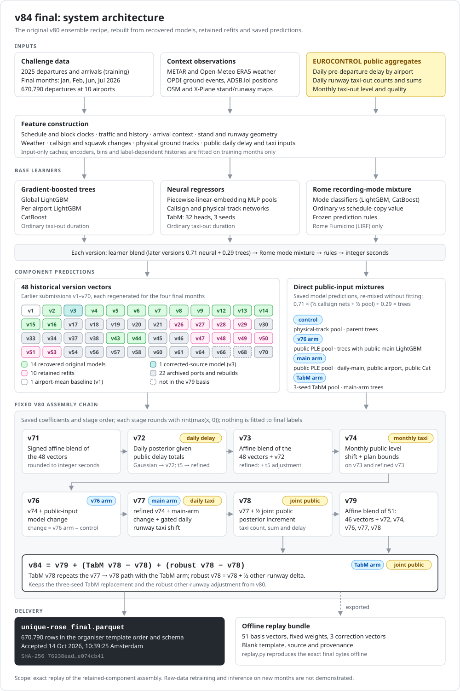

# Method and model identity

This repository predicts the **recorded taxi-out duration in seconds** for
departures at the ten challenge airports. The supplied records have noisy and
occasionally substituted clocks; predicting this recorded value is different
from estimating physical ground movement alone. All submitted predictions are
aligned to the organizer's movement IDs and serialized to the template schema.

## Model identities

| Identity | Evidence and status on 14 October 2026 |
|---|---|
| Original v80 | Best original Jan/Jul leaderboard result, **218.8525 seconds** on 344,841 departures. Some original neural weights were not saved. |
| v84 accepted final | Fixed v80 recipe reconstructed with recovered original trees, recovered v3 source and retained neural refits. Accepted on all **670,790** final rows at **10:39:25 Amsterdam**; no numeric final score published. |
| v83 historical final | Portable distilled ensemble; original leaderboard **220.9278**, historical Jan/Jul CV **289.607608**. Retained with its replay archive as rollback evidence. |
| C05/C07/C10 validation | Separate direct recipes under the four-month validation design; neither historical v80/v83 reconstructions nor the selected v84. |

The accepted final is uploaded as `unique-rose_final.parquet`; its remote SHA-256
matches the locally audited artifact:

```text
76938ead67f333e10a57290ad3cea71cb2aba85f94158de929724789e074cb41
```

[Selected final status](../release/SELECTED_FINAL.md) and the release manifest
bind submission, acceptance and replay records. Full computational and delivery
receipts are retained under `VALIDATION/runs/v3_20261014_v84_final/`.

## System architecture



Saved base-learner predictions form 48 historical version vectors and four
direct public-input mixtures. The fixed v80 assembly chain combines them with
EUROCONTROL public aggregates; the sections below describe each layer.

## Feature construction

The shared inputs combine supplied aircraft, operator, airport, stand, runway,
calendar and flight-plan clocks with traffic/history summaries. Label-dependent
histories and correction parameters are fitted on each fold's training rows.
Known arrival records provide context. METAR describes local conditions; OSM
and X-Plane maps provide stand/runway geometry; OPDI and ADSB.lol provide ground
event observations. Own-aircraft callsign/squawk changes and sparse positions
give additional views of observed motion. Missing observations and ambiguous
identity matches are represented explicitly. Sources, time conventions and
licenses are in [DATA_SOURCES.md](DATA_SOURCES.md).

Public daily pre-departure-delay and runway taxi totals are joined by their
published airport/date/runway scopes. Taxi aggregates use airport-local takeoff
dates; other sources retain their documented calendars. Public totals can have
different flight populations, exclusions and rounding from the challenge.
The historical final stack calibrates their mismatch using permitted training
data and uses robust uncertainty rather than treating the totals as exact
constraints on individual targets.

The held departure target and block-time aliases are masked before the new
four-fold feature APIs are called. Encoders, numerical bins and label-dependent
corrections are fitted from the allowed training months. The input-only caches
can be reused, but peer/arrival context is rebuilt for the permitted fold
population. These checks do not imply online, real-time deployment: the
competition supplies complete month-level movement context.

## Base learners and Rome mixture

Ordinary taxi duration is modeled with global and per-airport LightGBM,
CatBoost, and neural regression. The neural families use categorical embeddings,
training-fitted numerical transformations and piecewise-linear embeddings.
Physical-track models add a masked track encoder and observation-quality
inputs. The public TabM model uses 32 ensemble heads, each supervised by squared
error; inference averages their outputs. Three retained seeds reduce variation.
Architecture primitives come from PyTorch, `rtdl_num_embeddings` and `tabm`;
our domain feature construction, physical encoder integration, mixtures,
corrections and evaluation code are described in [THIRD_PARTY.md](THIRD_PARTY.md).

Rome requires a separate treatment for records whose taxi duration follows a
schedule-copy mode. Its ordinary regressor excludes the substituted training
targets. Classifiers estimate the recording mode and mix ordinary versus
clock-derived predictions. Frozen prediction rules and learned corrections are
then applied in their recorded order. This avoids forcing one ordinary
regression loss to explain two recording mechanisms.

## Accepted final: reconstructed fixed v80 ensemble

v84 retains the original v80 component coefficients, correction order and integer
rounding. Its 51-column basis includes reconstructed historical version outputs,
recovered original tree models, the corrected recovered-source v3 model and saved
neural refits where early states were absent. Later retained components preserve
the daily/public source, physical-track and callsign information. Model/input
identities and the distinction between saved original states, refits and retained
prediction vectors remain explicit in the dependency inventory.

For the ordered integer basis `P`, fixed historical coefficients `w`, and three
retained correction vectors, the final arithmetic is:

```text
v79_reconstructed = rint(max(P @ w, 0))
v84 = rint(max(v79_reconstructed
               + (tabm_v78 - v78)
               + (robust_v78 - v78), 0))
```

The first correction preserves the three-seed TabM replacement and the second
the robust other-runway adjustment. The exact coefficients, component order and
vector bytes are saved; none is newly fitted to final labels. Final assembly
uses nearest-even integer rounding at both recorded stages and preserves the
organiser's movement IDs and schema. `tools/v84_final/assemble.py` records the
full dependency computation; `tools/v84_final/replay.py` independently repeats
the retained-component arithmetic from the exported bundle.

v84 is not an exact recovery of original v80 predictions or weights. Its old-input
agreement measures reconstruction differences, not predictive error against
labels. No dedicated new v84 January/July or four-month CV score was produced;
historical v80 and v83 scores must not be relabelled as v84 validation. Acceptance
confirms that the final file was processed successfully, not its accuracy.

The standalone archive was independently extracted and replayed with networking
disabled, producing all 670,790 final rows and exact Parquet bytes. It includes
component predictions, coefficients, corrections, a blank template, source and
provenance rather than an embedded final prediction file. This verifies ensemble
assembly reproducibility; a complete clean-clone raw-data training rebuild and
arbitrary-new-month inference remain unverified.

## Limitations and reproducibility

Official leaderboard RMSE, historical two-month CV and the new four-month CV
measure different populations and cannot be substituted for one another. Model
selection used repeated development evaluation and public leaderboard feedback;
the final score is not known. Exact retained-artifact replay and clean retraining
are different reproducibility claims: missing historical models/raw snapshots
and hardware-dependent fitting mean a fresh training run is not promised to
produce byte-identical historical predictions. The reproduction guide records
what can be replayed, what needs acquisition, and what remains unverified.
